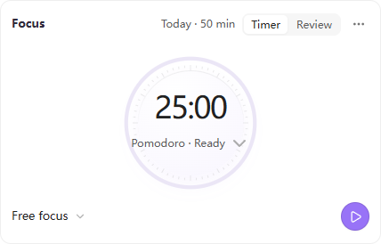
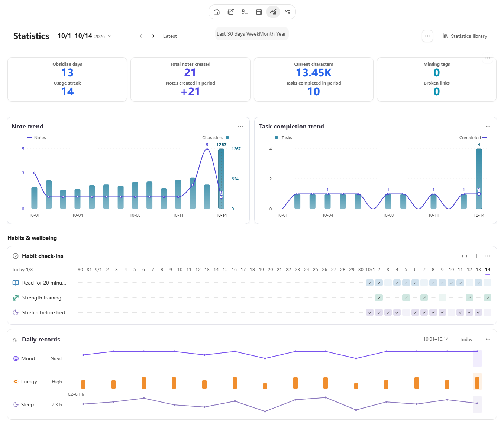

# Noria for Obsidian

**Language**: English | [简体中文](README.zh-CN.md)


<p align="center">
  
</p>

**Turn knowledge into action, and action into lasting knowledge.**

> This document follows the development version and includes unreleased improvements. See [Releases](https://github.com/jellyns/obsidian-noria/releases) and the [changelog](CHANGELOG.md) for published versions.

Noria connects daily records, notes, and knowledge management with planning, execution, and review. Its configurable Home brings together Task Board, Task Timeline, Calendar, projects, Inbox and MOCs, habits, trends, and Review Center, helping you see the current state, choose the next useful action, and let long-term knowledge support ongoing work.


Screenshots show the 0.5.0 public build in an isolated fictional workspace: a portfolio launch, an offline-reader app, daily habits and two weeks of notes. Every view reads the same source notes. The card layout, tag colors and 08:00–18:00 visible hours are configurable. Optional onboarding examples are smaller than this demonstration vault.

---

## Design Direction

| Principle | What it means in Noria |
| --- | --- |
| Visibility | Home statistics, heatmaps, task trends, note distribution, and daily-state signals make real work visible. |
| Low-friction planning | Task Board and Task Timeline help move from capture to arrangement without moving work into a separate app. |
| Configurability | Home is a widget dashboard; paths, scan scopes, modules, templates, filters, and appearance can be adapted to your vault. |
| Reusable data | The same Data API powers Home, tasks, timelines, periodic stats, review evidence, exports, and custom views. |

---

## Core Surfaces

### Home Dashboard

Home is Noria's overview surface. It brings "what needs attention today," "what has been accumulating recently," and "which entrances are worth revisiting" into one configurable dashboard: tasks, projects, Inbox, MOC links, habits, countdowns, weather, note trends, task completion trends, note distribution, heatmaps, and daily-state signals form a lightweight status board.

The statistics make workload visible. You can see recent note growth, task completion, habit continuity, daily-state changes, and vault distribution together. Inbox helps manage temporary capture; projects bring you back to active themes; habits support today's check-in and an adjustable history, initially 21 days; countdowns keep important dates inside daily awareness.

Home is also a widget dashboard. Built-in widgets can be enabled, disabled, reordered, and resized. You can add content widgets and, after explicitly granting trust under Maintenance, custom JavaScript view widgets from your vault. The default layout is only a starting point.

Each card keeps common actions in its header and settings in **…**. Resize from the edges; add or restore cards from the catalog. Removing a card keeps its configuration and leaves source notes intact. Each diary period has a default layout, with separate settings available for an individual note. Note, Base and Dataview cards reuse native rendering and Obsidian’s plugin installer.

Projects, Diary, Task Board and Timeline use the same task editor for content, dates, status and tags, with repeat rules and dependencies available when needed. A Home task title opens its source note; **Add next step** writes to the project’s existing task note, keeping the plan connected to its context.

Home cards share header icons, add controls, and an **…** menu. Cards in the same row align in height; resize a card from its bottom edge, or restore **Automatic height** from its menu.

MOC entries form an aligned grid with small color markers and a separate icon for a same-name Canvas. Add an existing note with **+**, or manage order and colors through **…**. Project, MOC, workflow, and Base links use a separate tab and reuse an open source, retaining Home and unfinished project input.


Markdown widgets can display existing briefings, suggestions, reviews or project-monitor notes. The Suggestions card also lets you add, edit and remove items in the corresponding daily note’s `## 建议` section. An external assistant such as Codex can write to that same source for you to review in Noria. Ordinary Markdown use needs no model connection.

### Task Board

The task board’s More menu provides weather ranges, a calendar time zone, and category colors. One time zone is shown at a time, preserving task instants: 09:00 in Beijing appears as 10:00 in Tokyo. On first activation, the device zone becomes the baseline for existing note times; edits and drags are converted back to that baseline. All-day dates are unchanged. Settings stay in plugin data, without bulk note rewrites. This applies to the task board and its editor; nonexistent or repeated DST edit times require adjustment.

Task Board turns tasks scattered across diaries, projects, and other notes into views you can plan from. Month view is useful for cycles and multi-day work, week view for near-term planning, day view for today's work, and matrix view for priority decisions.

Tasks remain in their original notes. New tasks can be written back to the matching diary, weekly note, or monthly note, while edits, drag actions, and completion changes stay in sync with Home statistics and the timeline.

In a busy month, scroll a week's task area to reach every task while its date headings stay visible. Multi-day bars scroll together and remain inside that week. Short timed blocks keep the title readable; open or hover a task for full details.


### Task Timeline

In project grouping, task labels use the available row width and off-screen tasks reserve no empty rows. Show schedule fits the project dates. A single unscheduled task opens its editor directly; multiple tasks open a compact picker. Canceling does not add a date.

Task Timeline brings dated tasks and project phases into one view. Use the main area for a broader plan or keep the sidebar open for the current schedule. Zoom from days into hours to see how a day unfolds.

Expand a project to give each task its own row: bars show intervals, dots mark single dates, and diamonds mark deadlines, with task names alongside. Unscheduled work stays accessible beside the project heading. Free layout combines tasks from different sources on the same timeline. Hover or focus for full dates and source details; drag the date row or minimap to move through time.

Name project or global time annotations to mark phases above the tasks. These periods can be edited without changing task dates, and tasks remain connected to their original Markdown notes.


*The screenshot shows project schedules in the development build, using fictional tasks.* [Timeline guide](docs/USER-GUIDE.md#4-task-timeline)

### Calendar

The sidebar Calendar locates period notes using Noria-managed paths, Obsidian Daily Notes, or a custom folder and naming pattern. Day, week, month, and year entries open Diary; missing notes are created on the first save. Quarterly notes and native entry points with Home disabled retain their existing creation settings.

### Habits

Habits separate today’s check-in from a longer view of your routine. Home shows today and recent dates, with columns adapting to the available width. Expand history to see 21 days by default, or change the range in **… → Card settings → History days**. Definitions stay in the habit registry and check-ins in dated Markdown; rest days, numeric targets and backdated entries use those same records.


Start a focus session with a task, or drag a task onto the Focus card. Switch between the timer and a review of recorded time in the same card. Linked tasks connect the board, timeline and focus records so you can compare your plans with the time you spent.

See the [task-to-focus walkthrough](docs/USER-GUIDE.md#focus-card) for drag-and-drop, switching tasks and opening the source.



### Trends And Statistics

Trends help you observe change across a period instead of judging each day. Note growth, task completion, habit and workload heatmaps, vault distribution, and daily-state signals share one time range and can be arranged as independent Home widgets.

Define daily record names, types, options and units, then add a trend or distribution from the same property. Statistics also support note properties and folders, with links back to source records. The statistics page shows primary charts directly; alternate styles for the same query can sit under Other styles. Configure a card in the statistics library and place it on Home or in a diary.



### Diary And Review

Persistent **Home / Diary** navigation makes it easy to return to your workbench. Diary records and review share one page, with the review below the body and accessible through the outline. Both use the same period, date and original Markdown.

Select the date to open the existing calendar on demand, or keep it in the sidebar. Diary brings together period tasks, earlier unfinished work, daily habit records, and date-note prose. The top-three focus appears only in the actual current day, week, month, or year. Longer periods provide a compact summary and on-demand statistics. Missing dates preview the configured template; typing autosaves to the date note without leaving the editor. Browsing alone creates no file, and the source icon can explicitly create and open one.

Tasks and habits use Home-style cards, with the current period’s priorities above its tasks. Use **…** to adjust display and layout, choosing the period’s default or only the current note. Layout settings stay in the plugin rather than the diary text.


Quick notes keep thoughts, links, and line breaks in the selected day's Inbox. Home and the **Noria: Quick note** command capture to today. Record mood and energy beside the diary; select a date in Daily State to return to its notes.


*Diary content from the example vault.* [Diary guide](docs/USER-GUIDE.md#5-calendar-and-diary)

Review Center gives daily, weekly, monthly, and yearly reviews the same reading and writing experience. Saved reviews open as readable sections drawn from your Markdown; an unwritten period opens ready to write. Edit one section or the full review, with changes autosaved to the corresponding date note. Open records, earlier reviews, or external analysis as references when useful; analysis joins your review only when you choose to add it. Diary and Review use Obsidian's reading/editing command and your assigned shortcut. An optional outline can help you start; there are no required GDD fields.

External review prompts start with a compact material file containing original records and relevant evidence. They favor concrete themes and grounded reflection, with source checks only for important gaps; there is no required word count or fixed GDD structure.

Select a passage in a record or review, then use the context menu or **…** to create a task or link an existing one. New tasks go to a project or daily tasks, with dates left optional. The passage stays intact, and the task keeps a link back to it. [Task adoption guide](docs/USER-GUIDE.md#86-create-or-link-tasks-from-records)


*Review content from the example vault.* [Review guide](docs/USER-GUIDE.md#8-review-center)

The same data layer powers Home statistics, task views, timeline summaries, periodic views, review evidence, and exports. This avoids each workflow scanning the vault in its own way and makes Noria data easier to use from external agents, scripts, and synchronization workflows.

### Configure It Around Your Vault

For a new vault, Noria recommends IPARA folders at the vault root. You can also choose one workspace folder or keep existing locations. Preview paths before confirming; later location changes do not move existing files. Diaries use built-in templates unless you choose your own .md. Settings are grouped by purpose, while everyday card controls stay on the page.

---

## Workflow

Noria is designed around a simple knowledge-work loop:

1. **Capture** in Inbox, diary notes, or project notes.
2. **Organize** through Home, project panels, MOC links, and Inbox actions.
3. **Plan** with Task Board and Task Timeline.
4. **Execute** from the day view, side timeline, and source tasks.
5. **Review** with reusable evidence and write the final reflection back into your diary.

---

## Quick Start

1. Follow the [installation steps](#installation) below and enable **Noria**.
2. Choose content locations on first opening: **IPARA** is recommended for a new vault; **Custom locations** can follow your existing structure. Select **Later** to start adding content without setting this up first.
3. **Add starter examples** is selected by default and can be cleared. Examples include editable tasks, habits, countdowns, Inbox notes and a project, without completed tasks or check-ins.
4. Open **Home**, add a task, an idea or a habit, and open its source note to see where it is saved.
5. Use Task Board or Timeline to arrange work, and Diary to keep records. Change locations and templates later under **Settings → Noria → Content & templates**.

Noria can follow Obsidian Daily Notes or its own diary settings. Default templates are built in; choose an existing Markdown template when you need a different format.

## Roadmap

- **Workbench experience**: continue refining module interfaces, responsiveness, interaction logic, and narrow-pane behavior so common workflows stay direct.
- **Composable Home**: improve card creation, visibility, ordering, and sizing, make notes, projects and frequently used pages easier to reach.
- **Feeds and briefings**: display briefings, suggestions and project updates written to agreed Markdown files by external workflows.
- **External agent collaboration**: help external agents organize plans, projects, habits, and periodic reviews within clear data and write-back boundaries.

---

## Installation

For normal use, install the release assets. Do not clone the source repository into `.obsidian/plugins/noria/`.

1. Download the latest release assets from [GitHub Releases](https://github.com/jellyns/obsidian-noria/releases/latest):
   - `manifest.json`
   - `main.js`
   - `styles.css`
2. Create the plugin directory in your vault:

   ```text
   .obsidian/plugins/noria/
   ```

3. Put the three files into that directory.
4. Restart Obsidian, or reload community plugins.
5. Enable **Noria** in `Settings -> Community plugins`.

After Obsidian saves settings, the plugin folder normally contains:

```text
.obsidian/plugins/noria/
  manifest.json
  main.js
  styles.css
  data.json
```

It should not contain `src/`, `tests/`, `scripts/`, `node_modules/`, or the full Git repository.

---

## Documentation

- [User Guide](docs/USER-GUIDE.md): installation, every module, Settings, common workflows, troubleshooting, paths, and developer reference.
- [GitHub Issues](https://github.com/jellyns/obsidian-noria/issues): bug reports and feature requests.
- [Community](docs/COMMUNITY.md): help, workflow sharing, and community channels.
- [Support development](docs/SUPPORT.md): voluntary support for Noria's maintenance.
- [Changelog](CHANGELOG.md): release history.
- [Contributing](CONTRIBUTING.md): local development, validation, and PR expectations.
- [Security](SECURITY.md): how to report security issues.

---

## Privacy and disclosures

- Noria requires no account and contains no telemetry, analytics, ads, or payments.
- Noria does not call an AI service. Review Center prepares local evidence and prompts that you may copy to a tool you choose.
- Weather stays off until explicitly enabled in settings. Choosing locations or adding starter notes does not enable it. When weather loads, Noria may contact IP-location and weather services such as `ipwho.is`, `ipapi.co`, Open-Meteo, or `wttr.in`; QWeather is contacted only when you configure its host and API key.
- Review Center keeps its Git evidence field compatible with external evidence providers, but Noria does not execute Git or other shell commands.
- Custom JavaScript view widgets are disabled by default. If you explicitly enable them under Maintenance, they execute a configured vault-relative JavaScript file with Noria and Obsidian plugin access. Noria blocks protocols, absolute paths, and path traversal; only enable this for files you trust. Built-in Noria views do not require this permission.
- Settings stay in the plugin `data.json`; supported secrets are stored through Obsidian SecretStorage. Snapshot and review exports remain inside the vault unless you choose another vault path.

---

## Development

Clone this repository only when you want to develop Noria itself.

```bash
npm install
npm run check
```

To install the current build into a separate test vault while preserving settings and recovery files:

```bash
npm run install:vault -- "/path/to/test-vault"
```

Replace the example path with a separate test vault. The command builds the plugin and copies only `manifest.json`, `main.js`, and `styles.css` into that vault's `.obsidian/plugins/noria/` directory. Existing settings, migration receipts, recovery drafts and other files are preserved. Installation does not remove extra files. See [build profiles](docs/BUILD-PROFILES.md).

---

## Project Layout

- `src/main.js`: Obsidian plugin entry and settings implementation.
- `src/runtime/`: Home, Task Board, Timeline, Review Center, and shared runtime sources embedded into `main.js` during build.
- `src/generated/embedded-runtime-sources.js`: generated embedded resource index. Do not edit it manually.
- `scripts/`: build, release check, and test-vault install scripts.
- `tests/`: Node tests for runtime behavior, settings, packaging, and release checks.
- `manifest.json`, `main.js`, `styles.css`: release assets installed into Obsidian.

---

## Data Storage

- Noria settings are stored in Obsidian's plugin `data.json`.
- Optional weather credentials use Obsidian SecretStorage.
- Review evidence and snapshot exports are written under the plugin cache unless you choose another output path.

---

## License

MIT. See [LICENSE](LICENSE).

---

## Community

Ask questions, share workflows, and suggest improvements. English and Chinese are welcome.

[Join Noria on Discord](https://discord.gg/JjCyDvFvgY) · [Obsidian Forum](https://forum.obsidian.md/t/noria-connecting-notes-projects-tasks-and-reviews-in-obsidian/118107) · [GitHub Issues](https://github.com/jellyns/obsidian-noria/issues)

Scan to join the Noria Discord community:

<a href="https://discord.gg/JjCyDvFvgY"></a>

[Community guide](docs/COMMUNITY.md)

## Support development

If Noria helps you, voluntary support is welcome and helps sustain development and maintenance. All features remain available to everyone.

Scan with **Alipay** to support Noria:

<a href="https://raw.githubusercontent.com/jellyns/obsidian-noria/main/docs/assets/support/alipay.jpg"></a>

[About supporting Noria](docs/SUPPORT.md)
