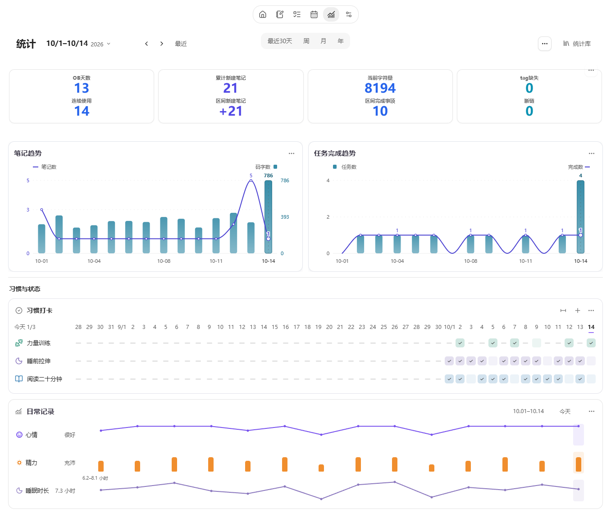

# Noria

**语言**： [English](README.md) | 简体中文


<p align="center">
  
</p>

**让知识进入行动，让行动沉淀为知识。**

> 本文随开发版本更新，包含待发布改进；已发布版本及变更见 [Releases](https://github.com/jellyns/obsidian-noria/releases) 与 [更新记录](CHANGELOG.md)。

Noria 是一款以灵活主页为中心的 Obsidian 个人工作台。它把日常记录、笔记与知识库管理，同计划、执行和复盘连接起来；通过任务看板、任务时间轴、日历、项目、收集箱、MOC、习惯、趋势统计与复盘中心，帮助你看清当前状态、专注下一步，并让长期积累重新服务于行动。


截图来自 0.5.0 公开构建，使用独立的虚构展示库：作品集发布、离线阅读应用开发、日常习惯与两周记录。各界面读取同一份原笔记；图中的卡片布局、标签配色和 08:00–18:00 可见时段均可调整。安装时的可选入门示例比展示库更简洁。

---

## 设计取向

| 取向 | 在 Noria 中意味着什么 |
| --- | --- |
| 可见 | 主页统计、热力图、任务趋势、笔记占比和日态信号让实际工作量更清楚。 |
| 低负担 | 任务看板和任务时间轴帮助任务从记录进入安排与执行，不需要搬到另一套应用里。 |
| 可配置 | 主页是小组件看板；路径、扫描范围、模块、模板、过滤和外观都可以按知识库调整。 |
| 可复用 | 任务、统计、复盘和外部工作流共享同一份 Markdown 来源，减少重复维护。 |

---

## 核心界面

### 主页看板

主页是 Noria 的总览入口。它把“今天要推进什么、最近积累了什么、哪些入口需要回看”放在同一张可配置看板上：任务、项目、收集箱、MOC、习惯、倒计时、天气、笔记趋势、任务完成趋势、笔记占比、热力图和日态分布共同构成一个轻量状态面板。

这里的统计用于让工作量可见：你能看到最近一段时间的笔记增长、任务完成、习惯连续性、日态变化和知识库分布，也能从收集箱管理临时收集，从项目区回到正在推进的主题。今日习惯用于快速打卡，倒计时则把重要日期放进日常视野。收集箱支持按住条目安排处理、修改和撤销，详见[操作图解](docs/zh-CN/USER-GUIDE.md#113-处理收集箱)。

主页也是一个小组件看板。内置组件可以启用、禁用、排序、调整尺寸；你也可以添加内容小组件，或在“维护”中显式授予信任后添加库内 JavaScript view 小组件。默认布局只是起点。

卡片标题栏把常用操作放在手边，**…** 收纳设置与布局。拖动边缘调整宽高，从卡片库添加或恢复内容；移出卡片保留配置，原笔记始终保留。日记的日 / 周 / 月 / 年各有默认布局，也可只调整当前笔记。笔记、Base 与 Dataview 查询可作为卡片显示，依赖安装复用 Obsidian 的插件管理。

Markdown 小组件可以展示已有的简报、建议、复盘或项目监控笔记。建议卡也支持直接添加、修改和删除，内容保存到对应日记的 `## 建议`。需要 Codex 等外部助手分析时，可让它写入同一份原文，再回到 Noria 查看；普通 Markdown 使用无需接入模型。

在项目、日记、看板或时间轴中安排任务时，使用同一套任务编辑器调整内容、日期、状态和标签，重复与依赖按需展开。主页待办标题直接打开原笔记；**记下一步**写入项目既有任务笔记，让安排与上下文保持联系。

MOC 入口按网格对齐，用小色点标识主题，同名 Canvas 保留独立图标。**+** 可选择已有笔记，**…** 集中管理顺序和颜色。项目、MOC、工作流及 Base 来源使用独立标签页，已打开的来源会直接复用，主页与项目输入保持。


### 任务看板

任务看板的“…”提供天气范围、日历时区和分类配色。日历时区一次显示一个时区，保持任务的实际时刻；例如北京时间09:00在东京显示10:00。首次启用时以设备时区作为既有笔记的时间基准，编辑和拖动写回该基准，全天日期不变。设置保存在插件中，不批量改写笔记。此设置目前作用于任务看板及其编辑器；夏令时不存在或重复的编辑时刻会提示调整。

任务看板把分散在日记、项目和其他笔记里的任务整理成可操作视图。月视图用于观察周期和跨天任务，周视图用于安排近期推进，日视图用于进入当天节奏，四象限用于快速梳理优先级。

任务仍然保留在原始笔记中。新建任务可以写回对应日记、周记或月记；拖动、编辑和完成状态会同步到主页统计和时间轴。这样任务既有看板的可操作性，也保留笔记系统的上下文。

月表任务多时，在对应周内滚动即可继续查看，日期标题保持可见；跨日横条随同周任务一起滚动，并保持在该周范围内。较小的时段块优先显示标题，悬停或点开可看完整信息。


### 任务时间轴

按项目分组时，任务名称使用所在行的可用宽度，日期范围外的任务不占空行；“查看安排”可回到对应项目的日期范围。“未安排”只有一项时直接编辑，多项时从列表选择；取消编辑不会添加日期。

任务时间轴将带日期的任务和项目阶段放到同一条时间线上。可以在主编辑区查看整体安排，也可以在侧栏常驻查看当前任务；从日尺度放大到小时，就能查看一天内的具体排期。

按项目展开时，每条任务独占一行：时段用横条、单个日期用圆点、截止日用菱形表示，名称始终就近显示。未安排的任务从项目标题旁进入。自由排布则将不同来源的任务放在同一时间范围内；悬停或键盘聚焦可查看完整时间与来源，拖动日期行或缩略图可平移时间范围。

通过命名的项目或全局时间标注，可以在任务上方标明阶段。编辑这些时段不会修改任务日期，任务仍保留在原来的 Markdown 笔记中。


*配图为开发版本中的项目安排，使用独立展示库的虚构任务。* [时间轴使用说明](docs/zh-CN/USER-GUIDE.md#4-任务时间轴)

### 日历

侧边栏日历用于定位周期笔记，可以使用 Noria 托管路径、Obsidian Daily Notes，或自定义目录与命名格式。日、周、月、年入口进入日记工作区，缺失笔记在首次保存时创建；季度和关闭主页模块后的原生入口保留原有创建设置。

### 习惯

习惯系统把“今天是否完成”和“长期是否形成”分开呈现。主页习惯卡显示今天与近期日期，日期列随卡片宽度调整，窄卡优先保留名称和今天的操作。展开历史后默认查看 21 天，可在 **… → 卡片设置 → 显示天数**调整范围。定义保存在习惯清单，打卡保存在对应日期 Markdown；休息日、数值目标和历史补记都沿用同一份记录。


专注卡可以关联一条任务，再开始计时；也可以把任务拖入卡片。计时与回看共用同一张卡，回看显示实际投入的时间。任务看板、时间轴和专注记录相互关联，便于对照安排与执行。手册提供[拖入任务到开始计时的操作图解](docs/zh-CN/USER-GUIDE.md#专注卡片)。


### 趋势统计

趋势统计用于观察一段时间内的变化，而不是每天评价自己。笔记增长、任务完成、习惯与工作量热力图、知识库分布和日态信号共享同一时间范围，也可以作为独立主页卡片重新排列。

可自定义日记记录的名称、类型、选项与单位，再从同一属性添加趋势或分布卡。统计也支持笔记属性和文件夹，点击结果可追溯原记录。统计页直接展示主要图表，来源和用途相同的重复样式可收在“其他样式”；在统计库中配置好一张卡后，可放到主页或日记。



### 日记与复盘

工作台顶部的**主页 / 日记**导航便于往返。日记正文与复盘位于同一页面，复盘放在正文下方，也可通过目录直达；两者共用当前周期、日期和原始 Markdown。

点日期按需打开原有日历，也可以放在侧栏。日记汇合当期任务、此前未完成事项、每日习惯记录与日期正文；动态三件事只在真正的本日、本周、本月、本年显示。周、月、年保留紧凑概览与按需统计。缺失日期先显示配置中的模板，书写后自动保存到对应笔记，并保持编辑位置；仅浏览不建文件，也可通过源笔记图标明确创建并打开。

待办和习惯沿用主页卡片样式，当前周期的重点放在待办上方。卡片右上角 **…** 可调整显示和布局；应用前可选择对应周期的默认设置，或仅当前笔记。所有布局保存在插件设置中，不写进日记正文。


随手记把念头、链接和换行原样留在所选日的 Inbox；主页和 **Noria：随手记**命令记录到今天。心情与精力可在日记旁填写，日态图上的日期能直接返回当天记录。


*示例知识库中的日记内容。* [日记使用说明](docs/zh-CN/USER-GUIDE.md#5-日历与日记)

复盘中心为日、周、月、年提供一致的阅读与书写体验。已有内容按 Markdown 的真实章节呈现，未写的周期直接开始书写；可以就近编辑一部分，也可以编辑全文，改动自动保存到对应日期笔记。需要时再打开原始记录、下级复盘或外部分析作为参考，分析由你主动选入正文。日记与复盘复用 Obsidian 阅读/编辑切换命令及当前快捷键。写作提纲按需使用，不要求填写固定 GDD 字段。

外部复盘提示词先读取保留原话和相关证据的精简材料，按具体主题展开有依据的判断；仅为影响判断的缺口补读来源，不再要求固定字数或 GDD 结构。

在记录或复盘中选中文字，用右键或 **…** 创建任务，也可关联已有任务。新任务可放入项目或日常任务，日期可以留空；原文保留，任务附上可回看的出处。[操作说明](docs/zh-CN/USER-GUIDE.md#86-从记录或复盘采纳任务)


*示例知识库中的复盘内容。* [复盘使用说明](docs/zh-CN/USER-GUIDE.md#8-复盘中心)

主页统计、任务视图、时间轴摘要、周期视图、复盘证据和导出能力共用同一套数据层。这样不同流程不需要各自重复扫描知识库，也让外部 Agent、脚本和同步流程更容易接入 Noria 数据。

### 按你的知识库配置

新库推荐使用根目录的 IPARA，也可集中存放或沿用已有位置。首次确认时会预览路径；以后更改保存位置不会自动搬动旧文件。日记默认使用内置模板，已有 `.md` 模板也可直接选用。设置按常规与外观、内容与模板、功能、连接与数据、高级与维护组织，常用卡片操作仍留在页面上。

---

## 工作流

Noria 围绕一个简单的知识工作循环设计：

1. **捕捉**：进入收集箱、日记或项目笔记。
2. **整理**：通过主页、项目面板、MOC 和收集箱动作处理。
3. **安排**：使用任务看板和任务时间轴。
4. **执行**：回到日视图、侧边任务轴和原始任务。
5. **复盘**：用可复用证据生成回看材料，再把最终反思写回日记。

---

## 快速开始

1. 按下方[安装说明](#安装)安装并启用 **Noria**。
2. 首次打开时选择存放方式：新库推荐 **IPARA**，已有知识库可选择 **自定义位置**。也可以点“稍后”，直接开始添加内容。
3. “添加入门示例”默认勾选，可取消；示例包含待办、习惯、倒计时、收集箱和项目，均可编辑，不生成完成或打卡记录。
4. 打开 **主页**，添加一条待办、一个想法或一项习惯，再打开来源笔记，看看它保存在哪里。
5. 需要安排时间时进入任务看板或时间轴；需要记录时打开日记。之后可在 **设置 → Noria → 内容与模板** 调整位置和模板。

Noria 可以沿用 Obsidian Daily Notes 或自己的日记设置。默认模板内置；需要不同格式时，选择现有的 Markdown 模板即可。

## 路线图

- **工作台体验**：继续优化各模块的界面、响应速度、操作逻辑和窄栏适配，让常用流程更直接。
- **可组合主页**：完善卡片添加、隐藏、排序和尺寸调整，让笔记、项目与常用页面更容易找到。
- **信息流与简报**：让外部流程写入约定的 Markdown，由主页展示简报、建议和项目进展。
- **外部 Agent 协作**：让外部 Agent 在清晰的数据和写回边界内，更好地协助组织计划、项目、习惯与周期复盘。

---

## 安装

普通用户不要把整个源码仓库 clone 到 `.obsidian/plugins/noria/`。标准安装只需要发行版三件套。

1. 从 [GitHub Releases](https://github.com/jellyns/obsidian-noria/releases/latest) 下载最新发行版资产：
   - `manifest.json`
   - `main.js`
   - `styles.css`
2. 在你的 Obsidian 库中创建插件目录：

   ```text
   .obsidian/plugins/noria/
   ```

3. 把三个文件放入该目录。
4. 重启 Obsidian，或重新加载社区插件。
5. 在 `Settings -> Community plugins` 中启用 **Noria**。

Obsidian 保存设置后，插件目录通常是：

```text
.obsidian/plugins/noria/
  manifest.json
  main.js
  styles.css
  data.json
```

不应出现 `src/`、`tests/`、`scripts/`、`node_modules/` 或整个 Git 仓库。

---

## 文档

- [用户手册](docs/zh-CN/USER-GUIDE.md)：安装初始化、全部模块、设置、常用工作流、FAQ、路径与开发参考。
- [GitHub Issues](https://github.com/jellyns/obsidian-noria/issues)：提交 Bug 和功能建议。
- [社区交流](docs/COMMUNITY.md#中文)：使用帮助、工作流分享与交流群入口。
- [支持开发](docs/SUPPORT.md#中文)：自愿支持 Noria 的持续维护。
- [Changelog](CHANGELOG.md)：版本变更。
- [Contributing](CONTRIBUTING.md)：本地开发、验证和 PR 要求。
- [Security](SECURITY.md)：安全问题报告方式。

---

## 隐私与披露

- Noria 不需要账户，不包含遥测、行为分析、广告或付费功能。
- Noria 不会调用 AI 服务。复盘中心为外部模型生成的复盘提供证据交接、可视化、编辑和明确采纳入口。
- 天气默认关闭，只有在设置中主动开启才启用；选择目录和添加入门笔记不会开启天气。加载天气时，Noria 可能访问 `ipwho.is`、`ipapi.co`、Open-Meteo 或 `wttr.in` 等定位与天气服务；只有配置 QWeather Host 和 API Key 后才会访问 QWeather。
- 复盘中心保留兼容外部证据提供方的 Git 证据字段，但 Noria 不会执行 Git 或其他 Shell 命令。
- 自定义 JavaScript view 小组件默认关闭。只有在“维护”中显式开启后，它才会以 Noria 与 Obsidian 插件权限执行配置的库内相对路径 JavaScript 文件。Noria 会阻止协议、绝对路径和路径穿越；请只对可信文件开启。Noria 内建视图不需要此权限。
- 设置保存在插件 `data.json`；支持的密钥通过 Obsidian SecretStorage 保存。snapshot 和复盘导出默认留在知识库内，除非你选择其他库内路径。

---

## 开发

只有在开发 Noria 插件本身时，才需要 clone 本源码仓库。

```bash
npm install
npm run check
```

如果要把当前构建结果安装到单独测试库，保留原设置与恢复记录：

```bash
npm run install:vault -- "/path/to/test-vault"
```

将示例路径替换为一个独立的测试库。该命令会构建插件，并只复制 `manifest.json`、`main.js`、`styles.css` 到该库的 `.obsidian/plugins/noria/` 目录。已有设置、迁移记录、恢复草稿及其他文件会保留，不自动清理安装目录。版本组合见 [构建说明](docs/BUILD-PROFILES.md)。

---

## 项目结构

- `src/main.js`：Obsidian 插件入口和设置页实现。
- `src/runtime/`：主页、任务看板、时间轴、复盘和共享运行时源码，构建时嵌入 `main.js`。
- `src/generated/embedded-runtime-sources.js`：构建生成的嵌入资源索引，不要手动编辑。
- `scripts/`：构建、release 检查和测试库安装脚本。
- `tests/`：运行时、设置、打包和发行检查的 Node 测试。
- `manifest.json`、`main.js`、`styles.css`：安装到 Obsidian 的发行版资产。

---

## 数据存储

- Noria 设置保存在 Obsidian 插件的 `data.json`。
- 可选天气凭据使用 Obsidian SecretStorage。
- 复盘 evidence 和 snapshot 导出默认写入插件 cache，除非你指定其他输出路径。

---

## 许可证

MIT. See [LICENSE](LICENSE).

---

## 社区交流

欢迎提问、分享工作流，并提出改进建议，中英文均可。

[加入 Noria Discord 社区](https://discord.gg/JjCyDvFvgY) · [Obsidian Forum](https://forum.obsidian.md/t/noria-connecting-notes-projects-tasks-and-reviews-in-obsidian/118107) · [GitHub Issues](https://github.com/jellyns/obsidian-noria/issues)

扫描二维码加入 Noria Discord 社区：

<a href="https://discord.gg/JjCyDvFvgY"></a>

[社区使用说明](docs/COMMUNITY.md#中文)

## 支持开发

如果 Noria 对你有帮助，欢迎自愿支持开发与维护。所有功能均向每位用户开放。

使用**支付宝**扫描二维码，支持 Noria：

<a href="https://raw.githubusercontent.com/jellyns/obsidian-noria/main/docs/assets/support/alipay.jpg"></a>

[支持开发说明](docs/SUPPORT.md#中文)
