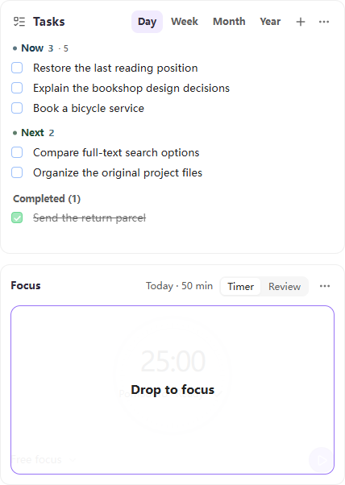
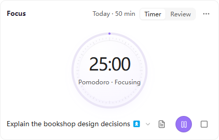
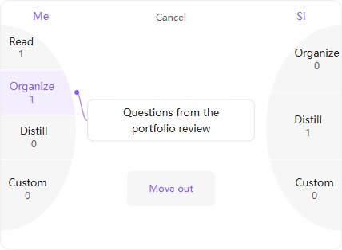

# Noria User Guide

**Language**: English | [简体中文](zh-CN/USER-GUIDE.md)

Noria connects daily records, accumulated knowledge, planning, execution, and review in one Obsidian workbench. It uses ordinary Markdown as its content foundation and provides a configurable Home, Task Board, Task Timeline, Calendar, Habits, Trends and Statistics, and Review Center so you can see the current state, choose the next useful action, and keep long-term knowledge connected to ongoing work.

This guide covers installation, each interface, common workflows and troubleshooting, with data locations and extension details in the appendices. It follows the development version and includes unreleased improvements; see the [changelog](../CHANGELOG.md) for published versions and the [README](../README.md) for an overview.

## 1. Installation And Initialization

### 1.1 Requirements

Noria is currently a desktop plugin and requires Obsidian `1.5.0` or newer.

When Noria is available through Community plugins, search for **Noria** and enable it. For manual installation, place only the three GitHub Release files in:

```text
.obsidian/plugins/noria/
|-- manifest.json
|-- main.js
`-- styles.css
```

Obsidian creates `data.json` after settings are saved. Do not copy `src/`, `tests/`, `scripts/`, or `node_modules/` from the source repository into a user plugin directory.

The Noria interface follows the Obsidian language. Unsupported languages fall back to English.

### 1.2 Content locations

On first enable, choose the recommended **IPARA**, **One workspace folder**, or **Custom locations** in the location dialog. **Later** defers the prompt for this version without creating folders. Reopen it from **Settings → Noria → Content & templates → Content locations → Change**. Saved changes read and create content in the selected locations; existing files stay in place. Configured installations retain their paths and templates on update without another prompt.

`06_Diary` is an editable suggested path, not a required built-in folder. Choose your existing diary folder if preferred. Installing Noria does not create folders. Confirming IPARA creates its eight top-level folders; other layouts create folders when notes are saved. **Use Obsidian diary location** lets you review and reuse its daily-note format and template without changing Obsidian settings.

### 1.3 Get started

1. Choose locations, or edit each one under **Content and templates**.
2. **Add starter examples** is selected by default: two open tasks, two habits, one countdown, an Inbox note and a project. All are editable and contain no completion history. Uncheck it to start empty. Confirming IPARA completes its eight top-level folders; **Later** creates none.
3. Confirm to open Home, then create your own task or diary note. Starter notes do not contain invented completions; existing files are never overwritten and repeating setup does not duplicate them.

Daily, weekly, monthly and yearly notes use built-in templates by default. Preview one, select an existing `.md`, or enter a path and **Save built-in copy**. Built-in help is available offline. Base files are optional native views, created explicitly from core files. An unused folder or list is not an error.

Choosing locations or adding starter notes does not enable weather or synchronize Obsidian settings. To use the same diary settings in Obsidian, first save/select a template, then review and apply **Obsidian integration**.

Tasks and Inbox have an add button even before setup. An empty card offers the same action in its content area. Inbox shows the destination folder before saving; **Change** opens its location setting and keeps the current draft.

### 1.4 First Acceptance Check

- Home opens, and an unspecified avatar uses the Noria mark.
- All four Task Board views can be selected.
- Task Timeline loads without opening Task Board first.
- Calendar creates period notes under the configured path.
- Habit, countdown, project, and MOC entries open their source files.
- Open Diary from the top navigation and switch to Review; Day, Week, Month and Year are available.
- Weather stays off until you enable it explicitly. Configure a location or provider only when needed.

## 2. Home

Use **Add card → Interaction** to select existing content or create questions. Supported answers are single/multiple choice, text, numbers and dates. The pencil button edits questions, options and defaults. Answers are saved in Markdown; external Agents can read them and respond through Noria's API, with results shown in the same card. Saving does not start an Agent. Multiple placements share the conversation; changed questions preserve drafts for review.

Open **Page settings → Manage pages** to rename, reorder, show or hide navigation entries, choose their pictures, or set the default entry. Create a blank page or start with the trends template, then use **Add a card** to compose it. Each page keeps its own layout while cards read the original notes and tasks. Restore hidden cards from the catalog; removing a custom page does not delete source notes. Diary and Day retain their dedicated features. The default applies to new workbenches; existing workspaces restore their saved page.

The catalog lists removed cards first so you can restore their original settings. An empty custom page offers **Add or restore cards**. If a note card cannot read its source, use **Retry** or **Card settings** to select a source; Diary keeps changes scoped to the current note. Cards unavailable in the current build retain their settings and original records.

Page entries use icons, with names on hover or keyboard focus and a selected background for the current page. Tab into navigation, move focus with the arrow keys, and press Enter or Space to open a page; Home / End move to the first / last entry. On narrow windows, open remaining pages from **More pages**. Change an icon in **Page settings → Manage pages**.

Home is Noria's central workbench, not a fixed collection of features. It organizes current state, next actions, knowledge entrances, and longer-term observations on one configurable page.


Screenshots use an isolated fictional workspace: a portfolio launch, an offline-reader app, daily habits and two weeks of notes. Every view reads the same source notes. The card layout, tag colors and 08:00–18:00 visible hours are configurable. Optional onboarding examples are smaller than this demonstration vault.

### 2.1 First-Screen Structure

The default first screen is organized as:

1. Identity, quote, weather, and overview metrics.
2. Top navigation for Home and Diary, with Day and Calendar links; Page settings provides Add a card to this page and Arrange cards on this page.
3. Today Tasks, Inbox, and Countdown cards.
4. Projects and MOC entrances.
5. Trends and Statistics; reviews are available from Diary.

The default order is only a starting point. Every major card can be managed as a level-one widget.

### 2.2 Capture And Task Input

Home no longer duplicates the capture and task input strip:

- **Capture** ideas, clues, and temporary records in Timeline.
- **Add tasks** from the Today Tasks card.

Resize cards in ordinary mode by hovering over a card or focusing its bottom-edge handle. Layout editing keeps handles visible. Home and Diary share this interaction, including narrow panes; the card menu restores automatic height. Captured material does not need to be classified immediately.

Drag a card’s right edge to resize across ten grid widths. Release to save or press Escape to cancel. More → Layout → Width offers six common proportions and a fine-adjustment slider; use arrow keys and Enter to apply a keyboard adjustment. Narrow panes stack cards without overwriting their saved widths. The focus dial fills and centers within the space above its bottom controls.

### 2.3 Today Tasks

Today Tasks group work by pace and current capability instead of keeping deadline pressure permanently visible.

- Incomplete tasks use clearer weight.
- The first open group shows its count and the total open tasks in the selected range, separated by a middle dot. Counts no longer crowd the card title.
- A Completed section previews the latest three completed tasks; expand it for more. Checked boxes and muted, struck-through text provide feedback. Uncheck a task to reopen it.
- A suggested first task is naturally sorted to the top with a quiet marker instead of a separate recommendation panel.
- Clicking a task opens its source; hovering shows dates, tags, project, and source details.
- Day, Week, Month, and Year ranges remain available and collapse into a period selector in narrow cards.

An unfinished task can continue the next day. Noria does not treat rollover as punishment.

### 2.4 Inbox

Inbox lists inputs in your Inbox folder. Filter by Me / SI and action in the header. Click an item to read and edit its source alongside the list. Further selections reuse that reading pane; Up and Down move between visible items. Pin a note to keep it: the next selection opens another tab on the same side. Hold and drag an item to a side action to assign work. The queue Base shares the same inbox-work property. Keep requests in the source note; assigning SI does not start an external assistant. See [Process Inbox](#113-process-inbox) for the steps.


### Habit Card

The Habit card shows today and recent dates in separate cells. Date columns adapt to the available width, keeping names and today’s controls accessible in narrow cards. Numeric habits show today's actual value and unit, including zero. Use the history icon to expand the longer, horizontally scrollable range; click again to return to recent days. The expanded range defaults to 21 days and can be changed in **… → Card settings → History days**. Click a date cell to backfill a check-in, or a habit name to edit its parameters.


### Focus Card

Use **Add card → Focus** on Home or in a diary. Choose Pomodoro or free timing inside the dial, and click the time to change its duration. Select a task at the bottom, or drag one onto the card.

1. Drag the **title** of an open task from the Tasks card onto Focus.
2. Release when **Drop to focus** appears. The timer starts for that task. Task titles in project cards and diary task lists work the same way.



Once started, the task name appears at the bottom. Pause or finish on the right, or open the source note with the document icon. Dragging does not move, reschedule or complete the task.



If a timer is already active, dropping another task asks you to finish and switch or cancel. Recorded time is kept; dropping the same task does not restart it. Without dragging, use the task chooser or the focus menu in the task editor. If a source has changed or cannot be located, refresh the task list and try again.

Switch **Timer / Review** in the header without interrupting a session. Review shows recorded time; choose a date at the lower left and use **… → Intervals & sources** for details. A separate time ring is available in statistics templates when needed.

### 2.5 Countdowns

Each item shows “In n days”, or “Today”; Home shows upcoming items only; expired and archived items remain available in the manager. Use **+** to add an item and select an item to edit its name, start and end dates. Progress uses the actual date range; an older item without a start date has no invented progress.

The colored bar displays time progress only. Date fields and setup hints stay inside the editor; click the item to edit its name, start date and deadline. Archive and restore items in the manager. Records stay in countdown Markdown; task-backed items update the original task.

### 2.6 Projects And MOCs

- Click a project to select its tasks. Project names stay in one row; the dropdown can find more projects without a separate search icon. The note and timeline icons in the card heading open the selected project’s source and schedule. The card’s **+** reveals task input; save to keep entering tasks, or press `Esc` to collapse it. The selected project and unfinished input are retained.
- MOC entries use an aligned grid that adapts to the card width. A small color marker identifies each entry; a same-name Canvas gets a separate icon. The display omits the trailing `·MOC`, while the source filename stays intact.
- Use **+** to choose an existing Markdown or Canvas file. Use **… → Manage content** to adjust order, color, or paths and remove entries. Removing an entry keeps the source file. File and folder renames in the vault update saved entry paths; a missing entry offers a replacement picker.

Project, MOC, workflow, and queue source links keep Home available and reuse an existing Markdown, Canvas, or Base tab. Ctrl/Cmd-click or middle-click opens another tab; Ctrl/Cmd+Alt-click opens a split. Hover preview follows Obsidian's Page preview settings. Home keeps links to source documents rather than duplicating their content.


Project management lists names and stages before opening a single item for editing. Choose an existing note or explicitly create a project note. An invalid existing path does not silently create a file. Hiding, completing or removing an entry keeps its source note.

### 2.7 Home Widgets

Home, Diary and custom pages support a tall card beside a vertical stack of cards. Drag blank heading space toward another card’s top or bottom edge to stack; use its left or right edge for separate placement. Release at the preview to save, or press `Esc` to cancel. **… → Layout → Stack with…** offers the same choices; **Place separately** removes the current card from its stack. Stack members share a width and keep independent heights. Narrow panes use one column; restoring a hidden card restores its stack. Layout stays in plugin settings and does not alter Markdown.

Open **Page settings → Add a card to this page** at the right of the top navigation to add built-in functions, a note / Base, statistics or an available third-party component. Home, Diary and custom pages share this entry. Configure the card with a preview of real content; restore hidden cards from the same catalog.

Choose **Statistics templates** at the top right of the card catalog, then browse Recommended, All styles or My templates. Dashboard statistics includes the overview, note and task trends, habit history, both yearly heatmaps, tag distribution and daily records. These retain their existing metrics and interactions, can be added to Home or custom pages, and can be saved as personal templates. The overview, note and task trends, both heatmaps and daily records also work in Diary, following the selected day, week, month or year by default. Tag distribution reflects the current library and stays on Home or custom pages; Diary uses its existing habit card. The gallery explains these two restrictions. Available basic chart types each have a default setup; record templates use configured fields where available. Choose a property if no suitable state field exists. Gallery drawings illustrate styles; the editor previews real data. Recent days includes today, and switching basic charts keeps the date range and filters. Templates store configuration without copying source data; removing one leaves existing cards intact. Ready-made dashboard cards retain their existing range and metric settings rather than offering arbitrary data-source substitution.

Segmented composition restores the earlier percentage strip as a configurable chart. It uses your current record property, supports Follow page for daily/weekly/monthly/yearly notes, and opens the corresponding records from a segment or category detail. Missing values are excluded; overlapping categories and negative values cannot form exclusive shares. Use counts, sums or distributions rather than averages or extrema. The same renderer also serves legacy periodic distributions.

Period trends offers two dual-axis templates: Notes and words, and Task count and completion rate. They work on Home, custom pages and diaries. Follow page is the default; fixed ranges and recent days are also available. Day/week/month buttons change the current view; save the default grouping in card settings. Auto uses days up to 45 days, weeks up to 180 days, and months for longer ranges. Task activity places completed tasks by completion date and open tasks by due/scheduled/start dates or the existing fallback. Rates are recomputed from grouped completed/activity counts, never averaged from daily percentages; periods without tasks have no rate. Values and definitions exposes full period keys, both metrics and their calculation rules. Legends identify the left and right axes. Point or touch the chart to inspect exact values; arrow keys select periods and Home / End jump to the endpoints. Resizing preserves the selected period and expanded values. Click the plot, press Enter, or select View sources beside the readout to inspect the same period: tasks are grouped into completed and open, and notes into newly created notes and diary character sources. Saved cards open the original note, locating the current line for tasks. Configuration previews are read-only and retain unapplied settings when you return. The note chart pairs new-note counts with diary non-whitespace character counts, including Markdown markup; this is not the amount newly written that day.

Home note and task trends support pointer or touch inspection and arrow keys / Home / End, with exact values in the hover or keyboard tooltip. Resizing retains the selected period; zero-valued bars have no height. Generic line and column charts retain the selected date when an in-place property edit refreshes their data.

**Focus time ring** is a shared statistics template for Home, diaries and custom pages. It reads actual focus segments from the timer and ordinary Markdown. The range follows the page by default; the date controls select a day within that range, initially the latest day with a record. Pauses are excluded, midnight crossings are clipped to the day, and overlapping time counts once. No records displays “—”; unrecorded time does not mean free time, and legacy intervals without segments are not inferred. Hover to inspect, click to keep a selection, or use the arrow keys and Home / End. Enter opens the source; **Intervals & sources** beside the date lists dense short segments separately. The center shows the daily total, or the duration and title of the selected interval. Click that title to open its source; hover it for the full time range. Enable **Compare task schedules** in card settings to show explicitly timed task schedules as a fine dashed outer ring, with actual focus on the solid inner ring. New time-ring templates enable this comparison; existing cards keep their setting. The center keeps actual focus and scheduled duration separate. Date-only tasks and deadlines do not imply durations; ambiguous legacy start/due pairs are not inferred. Cancelled schedules are excluded, completed schedules remain available for comparison, and overlapping scheduled time counts once. Clicking a schedule title opens its task; clicking a focus title opens the recorded segment.

The task board, horizontal and vertical timelines, and focus time ring share task category colors. The first eligible tag in the task text is used, with an exact match before its root tag. Status and overdue cues remain separate. Appearance settings accept Chinese and hierarchical tags. Focus inherits a category only when its source task can be matched uniquely; ambiguous names retain the default color. An explicit accent on a statistics card takes precedence.

In Obsidian Reading view and Markdown rendered by Noria, focus entries show the task name and actual duration first. Expand an entry for its timer mode and recorded intervals; select the task name to open the source note. Pauses are excluded, short records use seconds, and midnight crossings retain the date. Exact timestamps remain in the original Markdown and are visible in editing/source mode. Editing them still updates statistics from that same source.

**Goal progress rings** combines one to four independently calculated metrics in a shared statistics card. The default uses task completion and scheduled habit completion. Card settings can change each ring to tasks, habits or a numeric diary property and give it a name. Tasks use scheduled or due dates; habits use historical schedules; diary values use a sum or mean. Numeric targets apply to the entire selected range and are not multiplied automatically when switching between days, weeks or months. Leave the unit blank to use the record definition. Different units never become a combined completion percentage. Select a ring or legend item to see its value and target in the center. Select the center or **… → Selected metric & sources** for records and original notes. Arrow keys and Home / End select metrics; Enter opens sources. Percentages above 100 remain visible while the arc stops at a full circle. No records, no target and recorded zero are distinct. Source edits refresh the card while preserving selection and keyboard focus; incomplete or invalid data is identified instead of presenting a partial value as a complete result.

Under **Chart appearance**, choose colors and the density, scale, sample markers or legend options applicable to the chart. Line and column charts support a reference value in the same unit. Values outside a custom scale remain visible, with an expanded-scale notice. **Save appearance** reuses display settings without changing another card's data source, filters or reference value. Removing a preset leaves applied cards unchanged. Empty line and column charts omit unused axes; diary charts retain a date picker for adding records.

Each card’s **…** groups content actions, card settings and layout. Add to Home shares the data with independent display settings. Remove card keeps its configuration under **Add card → Removed**. Delete card requires confirmation and removes only this page’s placement, keeping source notes and other pages. Layout controls cover width, order, collapse, automatic height and copying; diary changes distinguish period defaults from the current note.

A Dataview card uses a note containing a query. Its dependency opens in Obsidian’s native plugin installer. Two cards can use separate notes; disabling the dependency affects those cards, and enabling it restores them. Note / Base cards reuse native rendering. Other plugins need an adapter or embeddable note content; arbitrary full plugin interfaces are not supported. See the [card provider API](CARD-PROVIDERS.md).


### 2.8 External Markdown Workbench

The **Suggestions card** accepts your own notes or results from an external assistant such as Codex. An empty card offers **Add suggestion** and **How it works**; **… → Using suggestions** remains available after suggestions are added.

The editor shows the actual destination: the `## 建议` section of the corresponding daily note. Link to `[[Project notes]]` and use each item's **…** to edit or delete it, with Undo after deletion. An assistant with vault access can edit that section while preserving the rest of the note; otherwise paste its response into the editor. Direct Markdown editing needs no external-assistant connection. Help and examples stay inside the plugin, without generating personal suggestions or guide notes.

Markdown widgets can read daily briefings, current suggestions, weekly reviews, and project-monitor files produced by external assistants or scripts. Noria displays the content, source handoff, and freshness state; the external workflow remains responsible for generating it.

### Home shortcuts

Keep frequently used notes and pages on Home. The Shortcuts card initially appears above MOC and can be moved. Select **+** to choose a note, Base, Canvas or Noria page, or paste a web or supported application link.

Each shortcut shows an icon and name. Its menu changes the display name, picture or opening location; drag to reorder. Removing a shortcut keeps the original file, and changing its display name does not rename it. Renaming or moving a file in Obsidian updates the shortcut. Only items you add appear here.

Open the original note and return to Noria without losing your place. Links open only when selected; adding one does not run it.

## 3. Task Board

Task Board organizes Markdown tasks from diary, project, and regular notes into four complementary views. Tasks remain in their source files.

### 3.1 Month

Use Month to review task distribution, multi-day work, deadlines, and workload over a longer span. Start with the overall shape, then move into Week or Day to arrange time.

Scroll within a crowded week to reach its remaining tasks. All seven days scroll together under fixed date headings, preserving continuous multi-day bars; other weeks stay in place. Editing or completing a task preserves your position. Completion uses the checkbox and color cues while titles stay readable.

Month excludes events tagged `#timeline` or `#tl` (including subtags) by default; Day and Week still show them. The statistics button explains the current rule. Expand it to inspect tag, cancellation, and overdue carry-over conditions, then choose **Filter settings** to change the existing settings. Tasks and counts update when you return.


### 3.2 Week

Use Week to arrange tasks and time blocks across the current week. Parallel tasks adapt title and time detail to the available width and height while preserving task identity.

When simultaneous tasks exceed the column width, **+N** groups the overflow beside that time range. Open it to read full names and times, then edit the original task. The list follows its count when resizing. Collapsed tasks remain included in statistics; their source notes and schedules are unchanged.

Crowded days show an expand button in their heading to open that date in Day view. Other headings reveal it on hover or keyboard focus. The date link still opens the diary. Switching between Day and Week keeps the date you are viewing; use Today to return to the current date.

In Day and Week, **Active** sets the visible start and end times or switches to **Full day**. The summary above the grid shows tasks before and after that range, or their count in narrow columns. Select the summary to inspect or edit the original tasks; use its arrow to expand or collapse both ends together. While collapsed, empty dates have no controls, and a grid with no such tasks has no empty summary row. Changing the visible range does not change task times, source notes, or statistics.


### 3.3 Day

Use Day for concrete daily arrangement. Untimed and all-day tasks stay at the top; tasks with a time range enter the hourly grid.


### 3.4 Matrix

Use Matrix to reconsider importance and urgency when the task pool grows. The four areas reorganize one task pool; they do not duplicate tasks.

Choose day, week, month, or year in the top toolbar. Counts beside quadrant titles follow the active filter. Open statistics and select a category, such as Scheduled, to filter; select it again to clear. Changing the period keeps the filter. Use Up/Down to navigate, Enter or Space to select, and Escape to close and return focus to the button. Dragging a task between quadrants changes only its quadrant, keeping its source note and dates.


### 3.5 Edit Tasks

Hover over a time block to read its full title and actual time range in the native tooltip. Multi-day tasks show both endpoint dates rather than using the visible segment's midnight boundary as the deadline. The readout closes when dragging starts.

Dragging in Month preserves the task's existing date fields and times; a date-only deadline stays date-only. Moving a block in Week or Day preserves its actual duration, even when a short task has a larger visual height. Small pointer movements do not reschedule. Press Escape or release outside a valid date cell to cancel.

Rescheduling keeps the task, child tasks and attached paragraphs in the original note; it does not create the destination day's note. Dragging an undated diary task adds a `scheduled` date without inventing start or end times. Month shows the new date, while opening the source returns to the original note. Diary cards also respect a future arrangement instead of displaying it early merely because its source is an older diary.

Week and Day show the full interval on one line when it fits, such as `09:00–11:30`. Narrow blocks may use two lines. When space is insufficient, the label shows only the start time or is hidden; the full interval remains available in the task tooltip and editor.

A floating preview shows the proposed interval. Drag near the top or bottom of a scrollable region to scroll automatically. Month range bars expose handles at their real endpoints; these change only the selected date, keeping its time. Middle segments across weeks have no endpoint handles. Rescheduling one task, including a diary task, offers **Undo** for about 12 seconds, extended while hovered or focused. Undo restores only that task line and refuses to overwrite subsequent changes to it. This shortcut does not yet cover batch editing.

The task editor supports:

- title and tags;
- priority and status;
- `start`, `scheduled`, `due`, `completion`, and related dates;
- start and end time;
- recurrence and before/after dependencies;
- source opening, saving, and deletion.

In any Markdown note, place the cursor on a task or plain text line and run **Noria: Edit or create task at cursor**.

Home, Diary, Task Board, and Timeline use this same editor. Start, Scheduled, and Due stay in fixed rows, with space for individual date and time digits. Type a time directly, or open the picker using the clock or `Alt+↓`. Expand repeat rules, dependencies, and lifecycle dates when needed. Dates and times are optional; changing the title adds no date, and editing one endpoint does not move the other. Save applies changes. Closing retains input for the current session; **Discard changes** clears it.

### 3.6 Create Period Notes

Selecting a date opens Diary in the workbench. A missing note is created on the first save, using the configured path and template. Quarterly notes and native-note entry points when Home is disabled still follow Calendar's creation-confirmation setting.

## 4. Task Timeline

Task Timeline is Noria's own time view for observing tasks across dates, time blocks, and stages. Tasks still come from source Markdown; the view provides organization, filtering, and interaction.


*Screenshots use fictional tasks from the isolated demonstration vault; this section follows the development version.*

### 4.1 Main Area And Sidebar

- The main editor area is useful for longer ranges, layer filtering, and broader inspection.
- The sidebar is designed to stay open as a compact view of the current schedule. Titles adapt to available vertical space.

Task Timeline should load after Obsidian restores the workspace and should not require Task Board to be opened first.

### 4.2 Navigation And Scale

One toolbar button switches between horizontal and vertical layouts. The vertical timeline mixes tasks, captures and diary records by date and recorded time. **Today** jumps to today's entries; scrolling up or down loads neighboring dates as needed. Click a date heading to navigate this timeline with the sidebar calendar without changing the diary page. An empty today still has a landing point. Horizontal span and vertical reading position are kept separately.

Complete or edit tasks in place. Completed tasks remain with reduced emphasis; vertical filters can hide them or open **Unscheduled tasks**. Folder and tag details are optional. Untimed entries do not add a time placeholder. Note creation and last modification are opt-in; last modification is not an edit history. Failed page loads can be retried at the affected edge without clearing existing entries. Dense days offer further expansion.

Long records start with a compact preview. **Read more** renders the complete Markdown in place; **Collapse** keeps the preview visible. Expansion is retained in the view state without changing the source note. Task completion and stream refresh preserve the focused control when it remains available, without taking focus from another panel. Failed expansion keeps the preview and allows retry.

In the horizontal layout, open **Filter → Visible range** to inspect and change the current duration. Expand **Custom duration** to enter hours, days, weeks, months or years; only **Save favorite** adds a shortcut. Use the panel's edit icon to reorder or remove favorites, or restore defaults while preserving custom entries. Custom spans retain their amount, such as **12 hours**. Edge arrows move by the selected span; months and years use calendar arithmetic. Resizing, refreshing and reopening preserve the endpoints; switching orientation does not rewrite the horizontal span. Free Ctrl/Cmd-wheel zoom displays **Custom** and the actual span. Named views also retain exact endpoints.

- Click **Today** to return to the current date.
- Use the wheel to pan horizontally through time.
- Drag an empty part of the time band to pan.
- Use `Ctrl/Cmd + wheel` to zoom.
- Drag either the bottom date row or the minimap to pan. Focus this area and use the arrow keys to pan or `+` / `-` to zoom.

Dates and the minimap share one continuous bottom area. There is one date row; at an hourly scale, the date appears on the first tick and when the day changes. Brighter minimap segments indicate the visible range.


### 4.3 Task Visuals And Write-Back

In the default free layout, task rows remain mixed across projects. The circle and short title identify the task; extra details appear during interaction:

- every task uses the same circle followed by its short title, positioned at its start time; tasks that started before the visible range stay at the left edge;
- hover or focus reveals full times, the duration rail, and source details; interval handles appear only during interaction;
- circle color expresses completion; completed titles keep the same color and weight as incomplete titles;
- full titles are shown when space allows and truncated only when necessary;
- clicking a title or circle opens the task in its Markdown source;
- dragging a task or interval boundary writes back to the source task line.

Before writing, Noria checks the source fingerprint and rejects an overwrite when the source has changed.

Choose **Filter → By project** for a project overview, then expand projects into individual task rows. Project titles open source notes; task titles open the shared editor. Only tasks in the visible date range occupy rows. Choose the Unscheduled count beside a project heading to select a task and edit its schedule. The neutral bracket shows the date coverage of the current tasks, not project progress or an explicit project plan. Dots indicate single dates and diamonds indicate deadlines. Very short intervals retain a small mark when zoomed out; hover for exact times. Their click targets are larger, while resize grips stay at the actual endpoints.

When an expanded project’s scheduled tasks are all outside the current window, **Show schedule** fits that project’s actual dates while preserving other projects and filters. Its arrow indicates earlier, later or both directions. Narrow panes show just the arrow; hover for the action and dates. Projects containing only unscheduled tasks keep their Unscheduled entry without inactive expand or fit controls.

The timeline icon on Home scopes the view to the current project and fits its task dates. Clear the project condition in Filter to return to all projects. Saved views retain grouping, project scope and expanded rows. Project layout displays tasks; use free layout for focus records and other activity layers. Switching layout retains the current project scope. Enable Focus in free layout to see that project’s scheduled tasks and actual work; saved views retain this combination. Focus on an unscheduled task also inherits its uniquely matched category and follows include/exclude tag filters. Opening focus still goes to its diary record, using the record anchor when preceding lines have moved. Project headings and tasks share the original timeline canvas without a left-hand name column. Names appear inside wide bars or just above short intervals; the overview retains its ordinary timeline position. Dragging still updates the original task without changing an independent deadline.

### 4.4 Layers And Filters

Use the Project selector in Filter to choose a project or return to all projects. Selecting a project expands it and fits its existing schedules; unscheduled tasks remain available from the count beside each project heading. **Visible range → Show all scheduled tasks** returns a panned view to the task dates in the current filter, and is disabled when there are no scheduled tasks. Favorite scales share a compact row; reordering, removal and restoring defaults appear when editing favorites.

Horizontal layers include tasks, marks, notes, Git, Noria, and Pomodoro. Pomodoro is off by default.

Filters support:

- showing or hiding completed tasks;
- text queries;
- including only specified tags;
- excluding specified tags.

Filters change only the view and do not modify tasks.

In the vertical layout, **Filter → View unscheduled tasks** opens tasks without an explicit date. The list starts at the top and keeps its position when refreshed. **Back to timeline** restores your previous reading position. Tasks remain in their source notes and can be edited through their titles; dragging them directly into Day/Week time slots is not yet supported.

Both orientations use the same task query syntax: `tag:#tag`, `path:folder`, and `status:open` / `status:done`. Combine these with ordinary text, or exclude tags and statuses with `-tag:` and `-status:`. Unscheduled tasks support the same conditions. Vertical records can be searched by body text and `path:`; task status conditions do not treat records as tasks. Filter settings are currently retained separately for each orientation and are not copied when switching.

### 4.5 Named Views

In either orientation, open **… → Save and manage views** to save the current setup. Filters hold content, visible range and layout controls. Horizontal views retain layers, completion state, query, included/excluded tags, time range and zoom. Vertical views retain tasks, records, note activity, completion state, query and task source display, while continuing at the current date.

Selecting a view restores its orientation and conditions; existing views are treated as horizontal. Changed conditions are marked as modified and replace the saved view only when you click **Update**. A failed save retains your input and the original view for retry. Renaming preserves conditions; deleting a view keeps the current filters and source records. Ordinary horizontal filters and the selected view are also restored with the Obsidian workspace.

### 4.6 Time Annotations

1. Click the toolbar button **Select a time range annotation**, then drag across an empty part of the main area to preview a range. You can also use `Shift + drag`.
2. Enter a name, choose a project registered on Home or **Global period**, and adjust the times and color.
3. Select **Save** to keep the annotation. **Cancel** or **Escape** discards the draft. Either action returns to normal panning.

Annotations appear as compact phase bands above the mixed task rows. Project annotations show **Project · Phase**. Overlapping bands use up to two rows; open **More phases** to access additional annotations. Click a band name to edit or delete it. While editing, dragging an endpoint changes the draft; use **Save** to keep it or **Escape** to cancel. Annotations do not change task dates. They describe phases or periods; they are not tasks or measured work time.

## 5. Calendar And Diary


The **+** action on a diary task card opens the shared task editor and saves to the selected day, week, month or year note. For a daily note, Scheduled starts at the selected date; Start and Due stay empty. Closing retains input for the current session; Discard changes clears it.

Choose **Add a card → Activity** to browse diary content, captures and task creation/completion by date. The current diary body is not repeated, and confirmed reviews remain in their own section. Load earlier records in batches of 7, 14 or 30 dates. Source buttons and event titles open the original note. Home uses the current week; Diary follows the selected period.

Card settings separately control records, task events, note creation and last modification. Task events require recorded creation/completion dates; planned dates are not treated as actual events. File activity is off by default. Last modification reflects the current file timestamp, not a history of individual edits.

Persistent **Home / Diary** navigation leads to a shared diary page: records above and the confirmed review below, reachable through the outline. They share the selected period, date, and Markdown source; reference material opens on demand.


Select the date title to open the existing calendar temporarily. **Open in sidebar** keeps it available beside the workbench; when that calendar is already visible, the date title uses it. Task Board, Timeline, and ordinary notes retain their independent views.

### 5.1 Main Actions

Daily, weekly, monthly and yearly journals use one Tasks card. The current period's top three priorities appear first, followed by other tasks. The first three completions are visible, with collapse and show-more controls. Priorities follow existing task priority and date ordering; past priorities are not inferred. Completion, editing, dragging to Focus and source links still act on the original task.

Overview, Tasks and Habits can share a row, with Record and Review below. Each diary period has defaults, while each note can customize its cards, statistics and layout.

Card definitions, filters, dimensions, ordering and folding are stored in Noria settings keyed by note path. Adding a card does not create or modify Markdown. Renaming a note or folder moves its settings. Prose, tasks and focus records remain in the source note.

Card settings apply to the current note. **Page settings → Default cards…** edits the shared starting point; **Restore default layout** clears local geometry and ordering while preserving the note's added cards and prose. Core and extension cards use the same note-specific layout rules.

Legacy `noria-view / diary-cards` blocks remain readable. On the first card edit, their configuration is adopted into plugin settings; historical source blocks are not automatically removed. No new blocks are generated. Copying a Markdown file alone does not transfer its Noria card settings; migrate plugin settings when transferring those arrangements. Markdown templates continue to own prose and headings.

- Hover or focus a card to reveal **…** for width, movement and folding. Layout changes are saved to the current note's plugin settings.
- Day, Week, Month, and Year change the period around the selected date. The date strip shows seven days in the selected week, adjacent weeks, months of the selected year, or adjacent years. The date title still opens the calendar.
- Select a month or year heading in the sidebar calendar to open its list. Choosing a month opens that monthly journal; choosing a year opens that yearly journal. The list stays open for further selections. The only middle-header action is Back to calendar, shown while a list is open. This action, selecting the same heading again, or Escape returns to the day grid without changing the viewed journal. Date-input popovers retain year → month → day selection without opening journals.
- **Today / This week / This month / This year** returns to the actual current period. Choosing a date closes the temporary calendar and returns keyboard focus.
- The date arrows use the same controls as the task panel. The pencil/book icon switches between editing and reading, as does Obsidian's reading/editing command with your current shortcut. The list, file, and refresh icons open the outline, source note, and reload action. Hover or focus a control for its label.
- Existing notes open for reading. Missing dates show the configured template ready to edit. Changes autosave while you write; saving keeps the editor, selection, and scroll position. `Ctrl/Cmd+S` saves immediately.
- Switching pages retains drafts, the cursor, and scrolling. Closing and reopening can recover unfinished text and its target date.


*Editing an example diary note. The book icon returns to reading; no separate Save button is needed for normal writing.*

### 5.2 Creation Behavior

Use **Page settings → Add a card to this page → Diary section** to name a card and select an H2 heading. Suggestions come from the current note and its configured period template; you can also enter a heading. Preview shows that section and its nested headings. Common card controls handle size, order, collapse and removal.

Each day, week, month or year layout shares its own configuration; changing the selected period reads the matching section from that period's note. The header pencil opens the original heading. If the note is missing, this explicit action creates it through the existing calendar template flow. Browsing and preview never create a note. Missing, duplicate and empty sections have distinct messages. Section cards are reading surfaces with read-only task checkboxes; use the original note or task card to edit.

In **Record card → … → Card settings → Display scope**, keep the default **Full note** or choose **Selected sections**. Select H2 headings from the current note or template, or add another heading. Sections appear in source order; managed reviews and today's habit records remain in their own cards. Missing or duplicate headings show a message instead of revealing other sections. Each period type keeps its own scope. This only changes the reading view: the pencil opens the full note, and an active editor retains its content and selection. Adding a separate section card never automatically removes that section from Record; select the desired scope yourself.

Browsing, focusing, or leaving an untouched template creates no file. The first text change is autosaved to the selected date; a habit check-in or quick capture can also create it using the same configured template. The source icon explicitly creates and opens a missing note using Calendar's creation settings. Switching dates or reading modes flushes pending edits to their original destination. An existing empty or frontmatter-only note stays as it is; Noria does not refill its template.

New built-in day, week, month, and year templates start with **Notes** and **Plan**. Inbox, habit records, and review are added when used. Existing custom templates remain unchanged, and date variables follow the selected period, including past dates. Rename, remove, or reorder headings freely. `cssclasses: [daily-clean]` scopes typography to date notes and inherits the theme and fonts. The action list reads tasks across their original sources, including earlier unfinished work; task titles open the shared compact editor, its source icon opens the original line, and checkboxes complete or reopen the original task. The top-three focus appears only for the actual current period. Checkboxes inside the prose preview remain read-only.

Diary and Home habit actions write dated records to the configured daily note. Definitions stay in Habits.md; actual values and targets are stored with each quantitative record. Past dates show recorded activity and offer explicit backfill; future dates cannot be checked in. Recording a habit can create a missing daily note. Week, month, and year show a compact task/habit/writing summary with independent statistics available through Add card.

You can check a task or record a habit while editing prose. Independent changes carry into the draft; overlapping edits still require comparison. Habit annotations, tags, and block links are preserved. Outline follows the current headings in both reading and editing.

File-change events for the current period note refresh clean prose without rebuilding date navigation or card layouts. A clean editor retains its instance and selection. Unsaved, conflicted, unadopted recovery drafts and active IME input are protected from external refresh; concurrent edits still use the existing conflict and recovery flow.

If saving fails or the source changes externally, the editor keeps your input and offers retry, copy, and recovery actions. Reopened recovery text waits for editing or **Use this draft** before saving; simply opening it does not overwrite the source. Review uses the same protection described in [Save protection](#85-save-protection).

Installation does not rewrite existing templates, embedded views, or historical notes. The older `focusPanel` and `habitCheckin` habit controls also write to the selected date note, supporting withdrawals and actual values; they require an explicit date. Existing registry check-ins remain readable, and date-note records take precedence for the same habit and day, including withdrawals. Review historical migration differences first; duplicate records remain available for comparison. Quarterly notes and native entry points with Home disabled retain Calendar's creation and confirmation behavior.

The date-note preset uses matching heading levels in reading and Live Preview. Its styles are maintained in the plugin. If your vault also enables the older `daily-clean` CSS snippet, disable that snippet in Appearance to use the plugin preset; you can keep the snippet file.

### 5.3 Date Sources

Calendar supports three sources:

- **Noria** uses Diary root and templates from **Content & templates → Diary & templates**.
- **Daily Notes** reads Obsidian Daily Notes settings.
- **Custom** uses a separately configured folder, naming pattern, and template.

Only fields relevant to the active source are shown, preventing multiple path systems from competing on the same page.

### 5.4 Quick Notes And Daily State

In a daily **Record** page, the square-pencil icon opens Quick note for the selected date. Home capture and the **Noria: Quick note** command use today; assign a shortcut through Obsidian if useful. The composer names its target date. Week, Month, and Year do not silently write a daily note.

Enter inserts a new line; `Ctrl/Cmd+Enter` saves. Links, paragraphs, and indentation stay in Markdown under `## Inbox`. Today's notes receive a time; past or future dates do not receive a made-up event time. You can supply `[HH:mm]` explicitly. Reading shows a quiet time column, with untimed notes after timed ones, without rearranging the source.

A first capture uses the selected date's configured template. Unfinished input survives changing dates; a failed save keeps the text for retry. Independent prose changes are preserved, while an unresolved conflict blocks capture. Recording a note does not create a task; use passage selection when you choose to turn it into one.

Mood and Energy beside the daily record use native menus. Clear removes a value; Focus is optional under **…**, and existing weather remains background information. Filling in a state on an empty date also uses that date's template.


*Example diary content.*

### 5.5 Diary templates and card layout

In Diary, **period toolbar … → Edit template** opens the actual template used by the selected day, week, month or year. **Change template** opens the corresponding existing settings: Noria templates, custom period templates, or Obsidian Daily Notes. Noria template inputs search Markdown files throughout the vault. Changes affect newly created notes only. An explicitly empty template starts blank; a missing or unreadable selected file stops creation with an error. Existing diaries can still receive captures and state updates after a template disappears. Only an unspecified template uses the built-in initial content.

The period toolbar ends with **Add card, Source note, and Page actions**. Add statistics through the shared card catalogue; their range follows the selected period by default. Record, Review, and added cards share the same layout. Drag blank header space to reorder, use the edges to resize, or use the Record/Review layout menu. Removing a card preserves source content; restore it from the catalogue. Each period type keeps its own layout. Place dated-note collections last, or embed the Base after your prose and review without duplicating it as a card.

### Dated notes in the diary

Dated notes stay in their own folders, named `YYYY-MM-DD Title.md`, with optional `HHmm` when distinguishing same-day entries. One shared Base can be embedded in daily, weekly, monthly or yearly notes, or displayed as a Noria diary card. For regular use, add the embed to your chosen period template. Noria does not append a separate list or rewrite existing diaries or templates.

Copy the [Dated notes Base template](templates/Dated%20notes.base) into your existing templates folder and insert `![[Dated notes.base]]` in the note body. The default “Records” view recognizes a leading `YYYY-MM-DD`, `YYYY-Www`, `YYYY-MM` or `YYYY`, optionally followed by a space and title. Weeks use ISO week-years and Monday–Sunday boundaries, including dates across calendar years. Unrecognized note names give no period results; they never imply today. Opening the Base independently shows all records. The “All” table remains available for manual filtering and configuration. The list shows titles, optional times and date groups; entries open their originals. Modification times and evolution paragraphs are not queried.

In the Noria diary, choose **Page settings → Add page card → Note or Base** and select the same file. This template follows the selected day/week/month/year even if the corresponding diary does not exist; viewing never creates a diary. The card hides the duplicate Base toolbar and omits the date group for a single day. Open **… → Manage contents** to configure the original Base; its changes refresh the card. Period context is bound only in memory, preserving the shared file. Each period layout still controls whether to include the card. This binding applies to this template; unrelated Bases are not rewritten. Custom filenames in native note embeds require matching Base rules, while Noria cards use the selected period directly.

## 6. Habits

Habits separate today's completion from long-term formation.

### 6.1 Today's Habits

Check in from the Habit card on Home or in today’s diary. Select today’s cell to record progress, **+** to add a habit, or its name to change settings. Expand history when needed; everyday use keeps names and today’s actions in view.

### 6.2 Habit Cards

The full habit card shows habit names, date columns, and check-in states. Consecutive completed days form connected bands; gaps and partial records remain distinct. Habit names reuse MOC card title size and weight so typography stays consistent across Noria.

Supported behavior includes:

- checkbox habits;
- numeric habits;
- targets and units;
- adding, editing, pausing, and marking a habit as established;
- refreshing sleep habits from `#tl/sleep`.

### 6.3 History And Heatmaps

Home keeps names and today's controls fixed. Recent days fit the card width; the history icon expands the configured range without increasing card height. Expanded history is horizontally scrollable and retains its inspected position through refreshes. The range includes today exactly once; **… → Card settings → History days** offers 7, 14, 21, 30, 60 and 90 days, initially 21. Select a historical cell to backfill that date. Streak counts appear only in expanded historical segments; today's column keeps its actual value or check-in state.

Each habit can have its own icon and color, with a scheduled streak and the actual number of checked-in days this week. Hover the summary for scheduled progress and extra check-ins. Streaks are independent of the visible window. Choose daily or selected weekdays and an effective date for schedule changes. Rest days and recorded pauses do not break a streak; extra check-ins on rest days do not increase it. An unfinished today is not counted as a break. Older habits keep their daily meaning, without inventing past pause intervals.

New habits can start in the past. Backfills before the first schedule count toward actual weekly check-ins and show a prompt to complete the historical plan. Select the habit name to edit its initial start date. Moving that date earlier extends only the first schedule, preserving later changes, pauses, and the original check-in notes.

Home and Diary share checkbox, numeric and time controls. Actual values stay separate from goals; failed saves retain input. The registry owns definitions and each date note owns its records. Renaming retains history, pause / established states keep past records, and a new goal does not reinterpret old check-ins.

Numeric target changes use **New schedule effective from**. New numeric habits keep target history from their initial start date; backfills use the dated target, while existing records retain their own target. An older habit's unknown target history is not invented when first changing its goal. If a backfill has no known target, the editor asks for **Target for this date**, saved only with that record. Once target history exists, use a new habit for a different type or unit to preserve historical meaning.

Numeric habits can explicitly bind to a daily record property, sharing one value with statistics. Heatmaps and period summaries remain available separately.

## 7. Trends And Statistics

Trends and Statistics are for observing sustained change, not evaluating yourself every day.

### 7.1 Shared Range

The statistics page brings together notes, tasks, habits and daily records. Primary charts stay visible; alternate styles for the same source and purpose can be collapsed. Open the statistics library to find a card by purpose, preview it and configure its source. Save a configured card to My templates or add it to Home.

When adding a diary statistic, choose This note or the period’s default cards. Cards that follow the page use the selected day, week, month or year; a fixed card range keeps its own dates. Cards share source records, while layout and display settings stay in the plugin.

Cards configured to follow the current page use one shared range control:

- Recent 30 days;
- Week;
- Month;
- Year;
- Custom range.

### 7.2 Note Trend

Note Trend shows newly created notes and the current non-whitespace character count of diary files. Character count describes current file content, not characters added that day.

Click a date position in either built-in trend chart, or select it with the arrow keys and press Enter, to inspect its sources. Note Trend separates newly created notes from diary character sources. Task Trend separates completed and open tasks; together they make up total activity. Selecting a source opens the note, focusing the current task line for tasks. Returning preserves the chart selection.

### 7.3 Task Completion Trend

This chart shows total task activity, completed tasks, and completion rate. Completed tasks without a completion date stay in an undated group instead of being forced into a day.

### 7.4 Habit And Workload Heatmaps

- Habit heatmaps can show one selected habit or the aggregate.
- Metric buttons appear in the header when space allows and collapse into one selector on narrow cards. Resizing retains the selected metric. Summary values show their units and use two columns on narrow cards.
- Workload heatmaps normalize note, task, and word-count activity into relative intensity. They are not exact time tracking.
- Task counts use the configured task scope and actual completion dates. The legacy **Open diary statistics** view uses the same basis in **Completed tasks heatmap**. Open tasks and completions without a date are not assigned to a day. Source failures show an error instead of substituting diary checkbox counts.

### 7.5 Note Distribution

Note Distribution groups notes by top-level vault directory, not by tags. It helps reveal long-term content distribution and is not a score for how many folders you have.

### 7.6 Daily Records

Unrecorded daily fields show their icon and name. Categories have state icons; scales use visual segments. In **Configure records → Edit → State appearance**, change each state's label, icon and color while retaining its original stored value. Use a separate field for a different property, type, unit or scale range so old records keep their meaning.

Mood and energy are optional presets that can be renamed or disabled. In Diary, **… → Record fields** lets you choose a preset, reuse a property or create a field. Configure options, a scale, a number / unit or a toggle, plus an icon and color. By default each field keeps one current value per day; replace a numeric value or add to its daily total.

Enable **Multiple entries per day** on an individual field to retain each entry. Numbers can use a daily total or the latest entry; states use the latest entry, which does not represent an overall feeling for the day. Open the field to add, click a detail row to edit, or delete that row individually. Time is optional and starts blank for historical dates. An existing daily value is retained as an untimed entry; it is never split into invented events.

Diary uses compact, field-colored controls that save a selection immediately. Home’s Daily records card aligns up to three fields on one date axis: bands for categories and independently scaled trends for numbers. Missing dates remain gaps, not zeros. Click the header date to choose a day or return to today; a range containing today initially selects it. Click a field name or value to edit the selected day. Names and values sit beside the plot on wide cards and above it on narrow cards, giving the plot the full row width. Hover or use the arrow keys on a chart to browse dates, then click or press Enter to edit. Saving retains the selected date. Choose displayed fields with the header filter icon, and expand Summary & sources for distributions, averages and source records.

Single values live in the date note’s native properties. Multiple entries live in a dedicated Markdown section; the property is a derived daily summary for Bases. Statistics and bound habits derive their values from the same details. Period averages count daily summaries, not individual events. Existing days keep their stored summary method and remain editable after multiple mode is disabled. If you edit detail Markdown manually, Noria reads those details; its next save updates the property summary. Do not overwrite the property to replace the details.

Disabling a field preserves history; renaming its display label keeps the property key. Use a separate field for a different unit or type so old values retain their meaning. Review material includes the configured names, units and values for the selected period, with details retained in the diary body.

“Choose displayed fields → Manage fields” and “… → Manage contents” open the same field list. Disabling a selected field preserves the card’s choice without substituting another field. Re-enabling restores it, and statistics can still read historical values. An empty card offers field selection or management when all fields are disabled. Diary choices are saved separately for daily, weekly, monthly and yearly layouts; statistics added from a record stay on the current page.


### 7.7 Custom Statistics Cards

Choose **Overview** from Add a card or Statistics templates to display focus, tasks, habits and diary characters in one full-width card. Configure rows 1–6 to select, hide or reorder metrics, including note counts and configured numeric daily records. In a diary it follows the selected day, week, month or year. Hover or use arrow keys to inspect a date across all rows; click or press Enter for sources. The day view shows time positions only for actual focus segments. Characters reflect the current non-whitespace diary contents, not historical editing volume. Existing page layouts are not automatically replaced.

The generic statistics configuration preview is read-only. Select dates and inspect values or sources; use the saved card or original note to enter or edit records. Canceling configuration does not save the card draft.

Preview sources open for reading inside the details window, with expandable properties and read-only task checkboxes. Back to sources restores the list; closing details returns to the unapplied settings with the draft and edit position retained. Sources opened from a saved card still go directly to the original note.

Choose “Add statistics card” from a record to prefill its property, or select Statistics in the card catalog and start from a record, folder, task or habit template. Configure Source → Field and calculation → Time range → Display, alongside a preview of actual data. Open matched counts and source details from the top-right chart button. Additional filters cover subfolders, tags, property conditions and grouping.

Task sources show the title, date and file path. Selecting one closes the list and focuses the current task line, even after surrounding paragraphs move it. Changed or ambiguous tasks prompt you to refresh the statistics. Ordinary note sources reuse an open tab; missing sources do not create empty notes.

Use count, sum, mean, minimum, maximum or category distribution, or reuse task and habit statistics. Diary cards follow the selected period; Home follows its shared range. A card can instead use fixed or all dates. Trends for ordinary notes require an event-date property or an explicit file creation / modification date. A current category is not a history of changes.

Use Statistics templates in the card library to browse or search templates. All styles starts with editable chart types. Returning from the editor keeps the selected category, search and template; unapplied edits can be kept or discarded.

Available displays follow the data type: numbers, lines, columns, horizontal bars, donuts, continuous strips, daily states, calendar heatmaps, target progress and period comparison. Overlapping categories and negative values cannot become donut shares. Task completion uses all tasks in the chosen due/scheduled cohort and their current completion state; habit completion uses historically scheduled check-ins through today. Targets use the same unit as the value. Comparison uses equally long ranges, truncates the current period at today, and does not calculate percentage growth from a zero baseline. Zero baselines and missing records are explained directly. Signed comparisons share a zero line, with negative values to the left and positive values to the right. Number summaries retain exact values with a smaller unit; click the number or either comparison period to inspect its own sources. No scheduled check-ins is not shown as 0% completion. Values above the target retain their actual percentage while the bar stops at full.

Click a donut slice or leader label to inspect or edit its source. Labels remain interactive when the legend is hidden; use Tab and Enter or Space with a keyboard. Hover or focus a category to highlight its leader and temporarily show its full name, value and percentage; leaving it clears the readout. Read-only donuts also support keyboard inspection. Dense labels receive more vertical room, and cross-side leaders stay outside the ring. Tiny shares retain their true size and can be opened from labels or composition detail rows. Horizontal bars share a common baseline and track width for accurate comparison.

Heatmaps and daily state grids label their months. Monthly calendars align each month to weekdays. Long heatmaps and strips initially reveal the selected date and retain selection and scrolling after source updates. Tab enters the selected day; use arrows and Home/End to navigate. Long heatmaps move one week horizontally and one day vertically; monthly calendars move one week vertically. Numeric heatmap colors follow signed values from low to high, with a scale legend. Zero, missing records and multiple states remain distinct.

The homepage habit and workload heatmaps retain their own yearly views and show each year in a cross-year range. Tab enters a day; left/right moves a week, up/down moves a day, and Home/End reaches the year's endpoints. Focus shows a temporary exact readout. New notes use their original creation dates, never weekly or monthly bucket totals. Completed tasks shares the configured task scope and completion dates with Task completion trend: explicit completion dates take priority, daily-note tasks without one use the note date, and tasks without any usable date stay outside day cells. Diary characters counts current non-whitespace content, including properties and Markdown syntax. Later edits change the count; it is not daily writing output.

Activity intensity scales daily completed tasks, new notes and diary characters to their respective daily peaks in the range, weighted 35%, 35% and 30%. Colors and active dates support relative comparisons, not hours worked or productivity; changing the range can change colors and rankings. Mixed scores are no longer displayed as output quantities. Open **… → How this is calculated** at the top right of the workload heatmap for the current metric's definition and the number of completed tasks without a usable date. The explanation follows the selected metric. The same menu is available on Home, Diary and custom pages.

Missing values remain distinct from zero and false; lines break across missing dates. Incompatible types or a specified mixed-unit property list the affected sources. Multi-select categories count each note once per category. Select a daily state or a single property source to edit it in place; multiple sources open a note chooser. Writes go to that source, and a changed original value blocks a stale edit. Missing diary dates support backfilling; future actual records are disabled. Summary numbers and task/habit charts show sources rather than writing an aggregate back to one record.


*Screenshots use isolated demonstration records.*

## 8. Review Center

Day, Week, Month and Year reviews appear **below the diary body**, also reachable through its outline. Records and review share the selected date and Markdown note. The preview shows confirmed text; recovered drafts and reference material remain separate. Review commands still open the requested period directly.


*The screenshot uses example content.*

### 8.1 Core Flow

1. Select a period and target date.
2. Read an existing review, or start writing if the period is still unwritten.
3. Use a section's pencil to edit it, or **Edit review** for the full Markdown. Both edit the same draft.
4. Open **Reference** when you need records, earlier reviews, evidence, or external analysis.
5. Changes autosave to the selected date note while you keep editing. Reading a different reference does not change this destination.

### 8.2 Reading And Editing

Sections follow the actual Markdown hierarchy and order, including custom and repeated headings. Short sections are shown in full; long ones offer **Read more**. Wide panes can pair two adjacent short sections, while narrow panes use one column. The outline icon opens a section menu. Source, reload, and reference icons stay beside it; hover or focus them for their labels.

The editor uses Obsidian's Markdown Source mode, with headings, lists, links, undo/redo, and `Ctrl/Cmd+S` for immediate saving. Autosave keeps the editor and cursor in place, and waits for IME composition to finish. Editing a section keeps the rest of the document intact. **All sections** and the book icon flush pending edits before returning to reading; Obsidian's reading/editing command and your assigned shortcut also work here. Use undo for ordinary corrections. To rename the review's outer title, edit the full Markdown.

**Add a writing outline** is optional. You can rename, remove, or add headings, write a few unstructured lines, or keep GDD as a personal reflection outline. Noria no longer creates mandatory Highlight, Deviation, and Blocker fields. Existing templates and historical notes are not rewritten on installation; custom templates remain under your control. Mood, weather, energy, and focus remain separate Daily State data.

### 8.3 References Across Periods

**Reference → Records** opens alongside the review in a wide pane. In a narrow pane it temporarily takes the reading area; close it to return to the same editor and cursor.

A monthly review can reference weekly reviews and follow **Read source records** into their daily notes. A yearly review can reference months or daily records. Missing lower-level reviews do not prevent reading the available records or writing the current review. Dates resolve through Noria's existing diary and Calendar paths. When viewing the current day's records, the review being edited is omitted from the reference preview to avoid repeating it.

Tasks in review previews are read-only. Open the source to change them. Legacy embedded dashboards and note transclusions link to their source instead of exposing controls that could write using the wrong line number; ordinary images remain visible.

### 8.4 Evidence And External Agents

**Reference → Analysis** keeps the separate proposal available. A notice identifies changed material or missing material-version information. **Prepare material** reads the current records and updates the material and prompt; it does not generate analysis or alter your review. If preparation fails, the existing analysis stays available and you can retry.

The development MCP connection supports review reading, material preparation and analysis submission (`reviews.read`, `reviews.prepare`, `reviews.submitAnalysis`). An external assistant saves its analysis separately and Noria requests a view refresh. In **Reference → Analysis**, choose sections to add to your review; existing prose is preserved. Changed material or analysis requires another inspection before submission. See [Review API](AGENT-API.md#reviews-and-reading-material). Installing the test build and native acceptance remain pending.

Noria prepares local evidence JSON and prompts but does not call a model inside the plugin. From **Reference → Analysis**, prepare the evidence, run your external workflow, then refresh to inspect its review note.

The prompt points to a `.material.json` file containing original prose, relevant task/state facts, and a source index. The full evidence JSON remains available for checking a specific gap. Monthly material prefers adopted weekly reviews; yearly material prefers monthly reviews, with daily records when lower reviews are missing. Executable view blocks and repeated statistics are omitted from the reading material; authored text is retained.

The default skill uses concrete theme headings, distinguishes facts from interpretation, and respects personal records without forcing them into action plans. Length follows the material. It asks for additional reading only when a named gap affects an important judgment; it does not require scanning the vault, all conversations, or every project's plans.

For an existing installation, use **Default review Skill → Install** in the review settings to update an unchanged older stock skill. Custom skills are preserved; **Reset** deliberately replaces them. Noria still does not run a model or automatically adopt its output.

**Add this section** adopts a selected analysis section into your review, preserves the existing text, and autosaves the result. Merely opening or refreshing analysis does not add it to your note. Adoption does not create tasks. Keep only material you want in your own review; observations and personal records need not become actions.

### 8.5 Save Protection

- Unsaved content enters a recovery draft.
- Noria blocks an overwrite when the target note changed externally.
- External analysis enters your review only through deliberate adoption.
- Your edits autosave; reopening a recovery draft alone does not write it to Markdown.

When a recovery draft's original source still matches, its text reopens for inspection. Edit it or choose **Use this draft** to resume saving. If the source changed, an older draft cannot be verified safely, or another draft remains for the same period, use **Drafts (n)** to inspect, copy, or use a selected draft. **Discard this draft** applies only to that draft.

After a save conflict, **Keep draft and reload source** preserves the local content before loading the latest source for editing. A successful save clears only the drafts handled by that save; other editors' drafts and unresolved content remain available. Hard breaks, indentation, and fenced code are preserved and included in conflict checks. Dates and periods that disagree are rejected.

The first save binds one complete review with two hidden-in-reading-mode comments. Keep both comments when editing the source; titles inside them are free to change:

```markdown
%% noria:review:start %%
## A few things from this month

### Worth remembering

Your own words.
%% noria:review:end %%
```

Incomplete or duplicate boundaries, ambiguous legacy review headings, and unfinished fences prevent saving. Use **Open source** to repair the note, then refresh. Content outside the review is preserved.

### 8.6 Create Or Link Tasks From Records

Select a passage while reading or editing a diary or review. Use the context menu or **… → Create task from selection**, or **Link selection to an existing task**. Both actions are also available as Noria commands, with shortcuts assignable in Obsidian.

For a new task, the shared editor lets you change the title and choose **Save to**: an existing project task note or daily tasks on the adoption day. Dates remain optional. Linking an existing task adds the source without changing its title, status, or schedule. Selecting text that is already a task opens that original task.

The original passage stays intact. The task stores an ordinary Markdown link and quotation beneath its checkbox. After saving, continue at the original reading or editing position; **View task** opens the task, and its **Back to record** icon returns to the source diary or review. Repeating the action on the same passage offers linked tasks and an explicit option to create another.

Closing the task editor keeps input for the current session; **Discard changes** clears it. Unresolved record drafts and changed source passages must be handled before a task can be saved. A task adoption action does not accept a recovery draft on your behalf.


## 9. Settings

Settings use five categories. Search opens and focuses the matching setting.

| Category | Contents |
| --- | --- |
| General & appearance | Theme, density, colors, personal profile and built-in help |
| Content & templates | Locations, diary sources and templates, lists, optional native files and query scope |
| Features | Task Board, Timeline, calendar display, general Home preferences, MOCs, review and module switches |
| Connections & data | Optional external assistants, weather and settings backups |
| Advanced & maintenance | Troubleshooting, performance and trusted custom views |

In **Content & templates → Content locations**, choose **Change**, select IPARA, a workspace folder or current locations, review the changes, then save. The workspace folder is edited in the same panel. Cancel changes nothing; saving never moves existing files. Individual locations remain editable.

**Diary & templates** owns Noria, Obsidian Daily Notes and custom date-path sources. Built-in templates can be saved as ordinary .md files; existing custom templates remain supported. Copying settings to Obsidian is a separate action with a readable folder, date-format and template preview. It is not offered when Obsidian owns the source.

Add, arrange, remove and configure cards in their pages. Global settings no longer duplicate card composition. Assign Inbox people and actions in the card; the old status and Home-lane editors have been retired. Existing legacy fields and optional Bases are not rewritten automatically.

**External assistants are off by default.** For MCP, open **Connections & data → External assistants → Set up connection**, enable the connection and copy Codex TOML or MCP JSON. Port and credential controls are expandable. Opening setup does not enable the connection. “Available” describes the local interface, not a connected client or an executed task. Suggestions and ordinary Markdown work without this interface; Noria does not run a model or schedule assistant work.

## 10. Markdown, Data, And External Workflows

### 10.1 Data Boundaries

| Layer | Content | Source of truth |
| --- | --- | --- |
| Content | Notes, tasks, projects, diary, habits, countdowns | Markdown or Base |
| Configuration | Paths, modules, Home layout, view preferences | Plugin `data.json` |
| Derived | Statistics snapshots and review evidence | Regenerable support data |
| Recovery | Unsaved reviews and preserved conflicting drafts | User input that cannot be regenerated; cleared only after the corresponding save or explicit discard |
| Credentials | Weather service keys | Obsidian SecretStorage |

Noria does not convert the vault into a private database. Ordinary Markdown remains readable and editable when the plugin is disabled.

### 10.2 Tasks

Noria reads standard Markdown tasks:

```markdown
- [ ] Organize experiment results [start:: 2026-08-04] [due:: 2026-08-07]
- [x] Complete the first draft [completion:: 2026-08-03]
```

Tasks can include `start`, `scheduled`, `due`, `completion`, `created`, `cancelled`, priority, and related fields. Task Board, Task Timeline, and Calendar edit the same source line.

### 10.3 Timeline Events

Tasks with `#tl/` tags and time fields can enter Task Timeline. Event templates live in `Event library.md`:

```markdown
- [x] Deep work [default_tag:: #tl/focus] [default_start:: 09:00] [default_duration_min:: 90] #tl/template
```

### 10.4 Habits, Projects, And Countdowns

- `Habits.md` stores active, paused, and established habits.
- `#habit` tasks are excluded from ordinary task lists by default.
- `Projects.md` uses groups and wikilinks for project entrances.
- `Countdowns.md` stores important dates in a Markdown table.
- Inbox help is built into the plugin; the optional `Inbox queue.base` provides an editable file and property view. Both the card and Base use the note’s `inbox-work` assignment.
- Unmodified default queue and guide files update automatically. Custom or untracked content stays intact, and deleted files are not recreated. To adopt a new version or restore the previous one, open Companion files in the advanced Inbox workflow settings. Restoring keeps your choice instead of automatically replacing it again. If the file was edited after updating, it stays intact and backup details remain available.

### 10.5 Diary And Review

Daily, weekly, monthly, and yearly notes remain ordinary Markdown. Diary and Review read and edit the same date note; task lists and statistics are provided by the workspace. Existing embedded view blocks remain available in older notes and templates.

### 10.6 External Content On Home

Markdown briefing sources use:

```text
name | path | role | freshness hours
```

For example:

```text
Daily briefing | Noria/Inbox/daily-brief.md | daily | 36
Current suggestions | Noria/Inbox/current-suggestions.md | current | 72
```

Available roles include `daily`, `current`, `weekly`, `project`, and ordinary note.

### 10.7 External Agent Collaboration

1. An external agent reads selected Markdown, review evidence, or a Noria JSON export.
2. The agent writes a briefing, suggestion, project monitor, or review result to an agreed file.
3. Noria displays the content and preserves source navigation.
4. Diary and final review content is written back only after user confirmation.

### 10.8 Security Boundary

- Custom JavaScript views are disabled by default.
- Only explicitly trusted vault-relative paths run.
- Protocol URLs, absolute paths, and path traversal are blocked.
- Noria does not silently move notes, reorganize folders, or rewrite unrelated prose.

## 11. Common Workflows

Noria does not require every module to be used every day.

### 11.1 Start The Day

1. Open Home and check current progress and active projects.
2. Choose a task that fits the current pace.
3. Check today's habits and nearby countdowns.
4. Open Task Timeline or Calendar only when a concrete time arrangement is useful.

### 11.2 Capture Quickly

- Use **Noria: Quick note** for today or the Diary icon for the selected date. Timeline also provides quick-note input.
- Use Task when the item is already actionable.

### 11.3 Process Inbox

Open an item to read its source and add instructions. Returning keeps your filters and reading position. A label such as “Me · Organize” is an assignment, not a progress status.

1. **Reveal actions:** hold the title or preview. You can also right-click, click an existing assignment, or press Alt+Enter from the keyboard.
2. **Choose who and what:** Me is on the left; SI is on the right. Drag to an action and release, or click the action. Custom lets you enter another instruction. Cancel or Escape returns to the list.



3. **Check or change it:** the assignment appears beside the preview, or below it in a narrow card. Undo is available in the receipt below. Click the assignment to change it, or choose **Custom → Clear assignment** to remove it.


Filter by Me / SI and action in the header. The optional `inbox-work` property in the original note is shared with `Inbox queue.base`; external edits refresh the card. Assigning SI records a handoff but does not start an external assistant. Keep instructions, materials and results in the source notes.

When the destination is clear, choose **Move out** in the action area and select an existing folder. Moving preserves the body, clears temporary `inbox-*` properties and offers Undo. **Keep in Inbox** leaves a plain link in the folder’s `Inbox.md`. Completing that entry removes only the link; its source remains.

### 11.4 Use Task Board

- Month shows longer-term distribution.
- Week arranges the near-term schedule.
- Day handles today's time blocks.
- Matrix reconsiders priority.

### 11.5 Use Task Timeline

1. Use Today, wheel pan, background drag, or the bottom navigation to locate the range.
2. Choose layers, completion state, and tag filters.
3. Click a title or circle to open its source; hover or focus for details.
4. Use a task's interaction handles when its schedule needs adjustment.
5. Add a named project or global time annotation when you want to show a phase without changing task dates.
6. Save a useful center, scale, layer set, and filters as a named view.

### 11.6 Advance Projects And Knowledge

1. Find a project in Home's Projects area. With the starter workspace, you can use one of the example projects first.
2. Enter a concrete action in **Add next step**. Noria uses the project's existing task note and task section. If several task notes are possible, choose the destination. The new task appears immediately, and failed writes retain your input.
3. Click a task title to use the same editor as Task Board. Tags, priority, repeat rules, and dependencies are available there too. The source icon opens the original task line. Dates are optional, and closing retains input for the current session.
4. Complete or reopen a task with its checkbox. Use **View all** for the remaining list and expand completed items when needed. Task Board and Task Timeline read the same original task; undated tasks remain undated until you schedule them.

Maintain stage outputs in the project note and connect reusable conclusions to the appropriate MOC.


### 11.7 Use Habits And Trends

Use Home for today's check-in and recent records, expanding longer history when needed. Open Trends and Statistics for broader habit history and heatmaps. Trends are more useful during weekly and monthly review than as a daily score.

### 11.8 Receive External Briefings

An external workflow generates Markdown and Home displays its summary and source. After reading, decide whether the content should become a task, project material, or long-term note.

### 11.9 Complete A Daily Review

Open the day, read what is already there or start writing, and edit only the part that needs attention. An outline and external analysis are optional. Save explicitly to the same day's note.

### 11.10 Review A Period

Inspect task, project, habit, Daily State, and trend evidence. Separate completed work, still-useful work, items to adjust, and items to stop, then keep only a small number of priorities for the next period.

### 11.11 Minimal Use

```text
capture a note -> choose a task -> update Markdown -> review when useful
```

## 12. FAQ And Troubleshooting

### 12.1 Standard Diagnostic Order

1. **Entrance**: confirm the module is enabled and the intended view is open.
2. **Source**: confirm the Markdown exists, is saved, and uses the expected format.
3. **Scope**: confirm paths, scan roots, dates, and tag filters include the target.
4. **Refresh**: use the view refresh or retry action, then reopen the view.
5. **Diagnostics**: run the installation check under Maintenance and save the report.

Do not begin by deleting `data.json`, rebuilding every file, or reinstalling the plugin.

### 12.2 A View Opens Blank

Check that the plugin and module are enabled, required paths exist, and the view is not still loading. Use Retry or reopen the view. If Task Timeline must be restored by opening Task Board after every restart, treat that as a startup recovery bug.

### 12.3 Tasks Do Not Appear

Check Markdown task syntax, whether the source is saved, scan scope, include and exclude tags, date range, and whether the current view hides completed, cancelled, undated, or habit tasks.

### 12.4 Board, Timeline, And Calendar Disagree

Compare date range, completion state, tag filters, and undated-task policy. The three views share task facts but serve different display goals, so item counts alone are not sufficient.

### 12.5 Timeline Is Slow Or Cannot Be Operated

Confirm that the pane is not a diagnostic shell, narrow the task scan scope, reduce unrelated layers, and check for source conflicts. Persistent blank state, unresponsive wheel panning, or recovery only after rerunning a command should be reported as a bug.

### 12.6 A File Was Created In The Wrong Folder

Check Diary, Inbox, Projects, template, and registry paths under **Settings → Noria → Content & templates**. **Change** previews the location changes before saving.

### 12.7 A Home Widget Has No Content

Check whether the widget is enabled, its source path exists, the file is non-empty, the briefing is still fresh, and the widget is not hidden. Stale Markdown should not present itself as current information.

### 12.8 Statistics Differ From Expectations

Check the shared time range, task completion dates, note scan scope, diary naming, habit source, and saved file state. Incomplete data is not the same as zero.

### 12.9 Review Cannot Save Or Refresh

Check the target period note and path. After an external agent updates its note, use Refresh. When a source conflict appears, compare the target note instead of forcing an overwrite.

### 12.10 Weather Does Not Appear

Weather is off before first initialization. After enabling it, choose a location or city, configure SecretStorage credentials when the provider requires them, and use manual refresh to verify the result.

### 12.11 An External Briefing Does Not Appear

Check that the target `.md` file was generated, source path and role are correct, modification time is within the freshness window, and the body is not empty.

### 12.12 Restore Settings

Prefer importing a settings backup, filling missing paths, restoring one module's defaults, or recreating missing files. Delete `data.json` only when you intentionally want to clear all settings.

### 12.13 Report A Problem

Include Noria, Obsidian, and operating-system versions, the affected module, minimal reproduction steps, a screenshot, the Maintenance report, and relevant console errors. Do not include API keys, complete private diaries, or unrelated vault content.

## Appendix A: Paths And Data Storage

### A.1 Recommended IPARA locations

| Purpose | Suggested location for a fresh installation |
| --- | --- |
| Inbox notes | `00_Inbox/` |
| Projects | `01_Projects/` |
| Diary and periodic notes | `06_Diary/`, editable; created when confirming IPARA or saving the first note |
| Habit, project, important-date and event lists | `02_Areas/知识库管理/`, created when used |
| Inbox Base | `02_Areas/知识库管理/Inbox queue.base`, optional |
| Periodic-note templates | Built-in; choose your own `.md` if preferred |
| Inbox instructions | Built-in help; existing guide notes are preserved |

### A.2 Centralized and existing locations

The centralized option retains `Noria/Inbox/`, `Noria/Projects/` and `Noria/Diary/`; its root folder is editable. Newly applying this option also uses built-in diary templates. Existing installations keep their current template files.

Changing locations does not migrate files. Setup does not generate a default avatar, quotes, guide notes, Base files, all periodic templates or today's diary. Existing lists and source notes are kept. Legacy timeline values are imported once into plugin settings with a verified recovery record; the old file is no longer read. Home is a plugin view and does not require `Noria/Home.md`.

### A.3 Plugin Configuration And Cache

Legacy timeline values are imported once into `defaultStrategy`, `sizing` and `timelineQuickSettings`. Edit quick blocks in **Features → Timeline → Quick time blocks**. The original file's effective priority is preserved; its Markdown and unknown custom fields remain intact. Verified recovery records live under `.obsidian/plugins/noria/migrations/`. They are recovery data, not runtime configuration or disposable cache.

Inbox cards and statistics share notes and linked entries from `Inbox.md`, grouped by `inbox-work`. Statistics describe the **current queue**, even when an earlier range is selected; only dated note creation is attributed to that range. Linked entries have no inferred creation date. Historical review documents and `inbox-*` fields are not rewritten.

New Inbox Bases contain All, Unassigned, Me and SI views. Bases list files; linked entries remain inside `Inbox.md`. **Content and templates → Inbox queue → Check updates** preserves custom columns, sorting and filters by default. Explicitly adopting the generated version replaces the Base with a verified backup and a Restore action.

```text
.obsidian/plugins/noria/data.json
.obsidian/plugins/noria/cache/stats/snapshots/
.obsidian/plugins/noria/cache/stats/tasks/
.obsidian/plugins/noria/cache/stats/review/
.obsidian/plugins/noria/cache/review/recovery-drafts.json
```

Markdown, Base, Canvas, templates, and final review notes should be preserved. Statistics caches and evidence can be regenerated. `cache/review/recovery-drafts.json` contains user input and must not be deleted as ordinary cache. The repository installer preserves existing `data.json` and `cache/`. A settings backup does not include recovery drafts; include the recovery file when backing up unsaved content.

### A.4 Review Paths

The final review is a section of the corresponding date note, such as `Noria/Diary/2026/2026-08-04.md`, `2026-W32.md`, `2026-08.md`, or `2026.md`. Daily reviews follow Diary root; longer periods use their configured Calendar paths.

External analysis artifacts are separate notes under Diary root:

```text
06_Diary/2026/2026-08-04-review.md
06_Diary/2026/2026-W32-review.md
06_Diary/2026/2026-08-review.md
06_Diary/2026/2026-review-month.md
06_Diary/2026/2026-review-week.md
```

The centralized option uses the same names under `Noria/Diary/`; custom paths retain your chosen location.


Time-block names, times and durations now come from the event-library Markdown. Built-in content is saved as a file only when edited. Single and batch additions share these definitions; an empty library or unchecked rows no longer brings default events back. “Choose blocks” stores only selection and scope: selected day, selected week (7 days), or a number of days from the selected date. Unchecked library rows are hidden from individual shortcuts but may still be explicitly selected for a batch.

Migration saves a recovery receipt first. Matching batch definitions reference existing rows; conflicting definitions are appended with a distinguishable legacy-batch label without overwriting original rows. Location presets affect both reading sources and creation locations. They do not move existing files or replace selected diary templates; saving an unchanged location draft makes no changes.

### A.5 Migration And Backup

Preserve user content, Noria registries and templates, final review notes, and a settings export. Statistics caches usually do not need to move. SecretStorage credentials such as weather keys must be configured again on a new device.

## Appendix B: Advanced And Developer Reference

### B.1 Extension Boundaries

Noria provides three extension surfaces:

1. Markdown file contracts;
2. versioned JSON exports;
3. trusted custom JavaScript views.

Internal DOM, CSS class names, cache implementation, refresh hooks, and source-module paths are not stable public interfaces.

### B.2 Custom JavaScript Views

Custom views are disabled by default. When enabled, vault JavaScript receives access to Obsidian, Noria, `window`, and `document`; it is not a security sandbox.

```js
const bridge = input.noriaBridge;
const result = await bridge.data.getSnapshot({
  preset: "home",
  range: { mode: "last30" }
});

const el = document.createElement("pre");
el.textContent = JSON.stringify(result.range, null, 2);
input.mount.appendChild(el);
```

Run only code that you wrote or reviewed, and prefer the injected `input.noriaBridge`.

### B.3 Public Data API

The development version also exposes `app.plugins.plugins.noria.api` (version 1) for task queries/date/status updates and daily suggestion reads/updates. See [External Agent API](AGENT-API.md) for inputs, conflicts, refresh and lifecycle behavior. The existing Data API below is unchanged; task writes use the new API's `ref`, not the Data API `identity`.

```js
bridge.data.resolveRange(request)
bridge.data.getSnapshot(request)
bridge.data.getTasks(request)
bridge.data.getTimelineAnnotations(request)
bridge.data.getTimelineTraces(request)
bridge.data.getPeriods(request)
bridge.data.getReviewEvidence(request)
bridge.data.export(request)
```

`data.invalidate()` is an internal refresh hook and is not part of the public contract.

### B.4 Ranges And Presets

Ranges include `last30`, `week`, `month`, `year`, `custom`, and `homeCurrent`. Built-in presets include `home`, `board`, `timeline`, `periodic`, `review`, and `exportAll`.

### B.5 Snapshot

```json
{
  "meta": { "schemaVersion": 1, "request": {}, "resolvedRequest": {}, "policy": {} },
  "range": {},
  "granularity": "day",
  "domains": {},
  "views": {},
  "warnings": [],
  "sourceCompleteness": {}
}
```

Callers must inspect `schemaVersion`, `warnings`, and `sourceCompleteness`.

### B.6 Task Facts And Write-Back

Task identity is determined by:

```text
sourcePath + line/blockId + fingerprint
```

Write-back must locate the source Markdown, verify the fingerprint, modify only the target task line, and reject an overwrite when the source changed. A renderer does not modify the vault directly.

### B.7 JSON Export

```json
{
  "exportKind": "noria.snapshot",
  "exportVersion": 1,
  "exportedAt": "",
  "noriaVersion": "0.5.0",
  "payload": {}
}
```

Supported kinds include `noria.snapshot`, `noria.tasks`, and `noria.reviewEvidence`. External tools should parse by `exportKind` and `exportVersion`.

### B.8 Compatibility

Extensions should check `bridgeVersion` and data `schemaVersion`, feature-detect optional fields, avoid depending on internal property order, never edit `data.json` directly, and never read or print SecretStorage credentials.

### B.9 Source Validation

```bash
npm ci
npm run build
npm test
npm run release:check
```

The public installation package contains only `manifest.json`, `main.js`, and `styles.css`.


### Pictures and date navigation

Card, habit, record-field and state appearance settings share one picture picker. Search the host application's icons, enter an emoji, or select PNG, JPEG, WebP or SVG images from a vault folder, optionally including subfolders. Images keep their original colors; line icons inherit the content color. Stable image references follow file and folder renames within the vault. Missing images can be replaced or reset to the default.

Change home card pictures in Card settings. Built-in diary cards offer Change picture in their header menu; layouts remain shared separately by daily, weekly, monthly and yearly notes. Action icons keep a consistent meaning.

The date strip arrows move a group of dates. The row below combines the date range, period controls, return-to-current action and document actions. Narrow cards keep editing visible and collect secondary actions in More. Clicking the range opens the existing sidebar calendar on its day grid. Month/year headings open lists whose entries directly open the corresponding journals. The list remains available; the middle-header calendar icon returns to the day grid. Review actions sit beside the Review heading.

Built-in home, diary, task calendar, Timeline and statistics views run without Dataview. Dataview remains optional for user-authored Dataview queries; it is not needed for Noria's native data queries. New habits use semantic default pictures; explicitly selected pictures and colors are preserved.

Daily record charts use compact bands for scales and trends for continuous numbers. Missing data is distinct from zero. Completed habit runs show their count in the last block, starting at two. Counts use the complete history and historical schedule, independently of the displayed history window.

### Card layout gestures

Custom statistics pages can group cards by topic. In Manage pages, open the page's menu and enable “Group by statistics topic”; new “Trends and statistics” pages enable it automatically. Overview metrics and pinned trends appear first, and each topic's main charts stay visible. Alternative generic styles with the same source, query and purpose start under “Other styles”, which remembers its open state. Different periods, filters, totals and comparisons are kept distinct. Use a card's menu to choose “Always show” or “Move to other styles”, or pin it to the top. Layout editing exposes the original card grid, retaining settings, widths and stacks. Previous whole-topic collapse settings upgrade to this presentation.

The page's Statistics library supports topic filtering and template search. Note trends combine a new-note line and diary-character bars on separate axes. Task trends combine activity bars and a completion line on one count scale. Only selected values and each series' maximum are labelled. Arrow keys select dates; click or Enter opens sources. Home, Diary and Statistics share this presentation, date range and counting rules, without a separate summary-column mode. Page organization stays in plugin settings.

The function picture stays at the far left, frequent actions on the right, and the `…` menu at the far right. Collapse or expand a card from that menu; its title and menu remain available when collapsed. Diary Record and Review sections use their own `…` menus in the same way. They save edits before collapsing and remain visible if saving fails. Drag blank space in the card header to reorder; text, links and buttons retain their normal behavior. Drag the outer right edge to preview a snapped width, release to save, or press Escape to cancel. At narrow viewport widths cards use the responsive layout; the Layout submenu sets the preferred width for a wider view. Height remains adjustable at the bottom edge without entering layout mode.

The native header menu retains content management and Card settings. Its Layout submenu contains Narrow, Medium, Wide, Full row, Move up, Move down, Automatic height, Collapse/expand, and supported Duplicate card and Remove from page actions. Every item has an icon and a short label; the current width has a checkmark. Remove from page retains configuration, contents and position: use Undo or Restore in Add a card to bring it back. There is no separate Hide action. Diary Tasks, Habits, Record and Review support title and picture changes in Card settings, without rewriting source headings or contents. Width is configured only under Layout. Use Move up and Move down for keyboard or touch reordering; with the width handle focused, arrow keys adjust width; the height handle's Home key restores automatic height. Daily, weekly, monthly and yearly diary layouts remain separate.

Default mood pictures share one expression family, energy uses five sun states, and focus uses converging rings. Empty fields remain muted. Pictures and state labels remain customizable, and these default pictures are also available in the shared picture picker. Legacy default pictures use the refreshed artwork; custom pictures and state overrides are retained.

New focus records write start/end times at second resolution, without milliseconds. Cross-day dates and paused intervals remain explicit. Legacy millisecond records remain readable; the internal timer still uses milliseconds. Summary displays use minutes or hours where appropriate.

Card menus support Add to Home for portable cards: source data is shared, display settings are copied, and later layouts are independent. Identical Home placements are reused. Remove from page keeps configuration in Add a card → Removed; Delete card confirms removal of this placement only. Diary exclusions leave period defaults and Markdown intact. The record calendar replaces the retired generic heatmap and state grid; existing queries migrate without changing their data.
